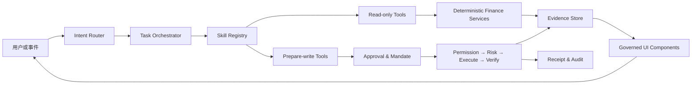
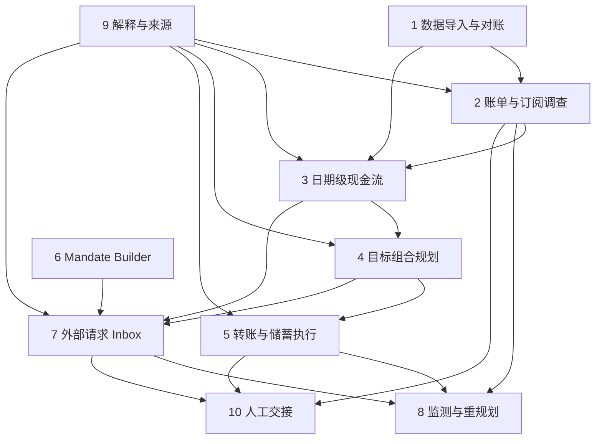

# NOVA v0.6 Agent & Skill Specification

> 2026-10-28 实现增补：方案 B 的 Registry 已扩展为 13 项，当前权威契约为 `shared/contracts.ts`、`server/skills/registry.ts`。新增 `recipient_and_split_coordinator`、`investment_lifecycle_manager`、`card_lifecycle_manager`。Mandate 与外部旅行请求已提供有会话、引用和预算校验的只读适配器；所有 13 项都不能直接执行金融写入。新增输入只接受对象引用，不接受任意金额、工具名、原始指令或批准 Token。写操作从消费者精确确认进入统一审批链路。具体交付边界见 [六场景实现说明](docs/SIX_SCENARIO_IMPLEMENTATION.md)。以下十项内容保留为原 v0.6 设计历史，不代表新版 Registry 仍限于十项。

> 状态：提案稿，须与 v0.6 PRD 和 `USER_FLOW.md` 一同审批
> 适用范围：NOVA 应用内 Agent，不是 Codex 开发技能
> 原则：Skill 负责可重复任务；确定性服务负责财务事实、计算、权限和写入

## 1. 目的

本文将 NOVA 的能力组织为 10 个有明确边界的内部 Skill。Skill 不是一段更长的 Prompt，也不是把现有页面换一个名字；每个 Skill 都必须具备：

- 清楚的触发条件和退出条件。
- 严格的输入/输出 Schema。
- 白名单工具与权限等级。
- 可核验的证据引用。
- 用户可见的 UI 输出。
- 写操作的确认节点。
- 失败、取消、过期和恢复规则。
- 独立评测集。

## 2. 总体架构



### 2.1 组件职责

| 组件 | 职责 |
| --- | --- |
| Intent Router | 选择 Skill 或要求澄清；不执行工具 |
| Task Orchestrator | 管理任务状态、预算、取消、恢复和 Skill 交接 |
| Skill Registry | 声明 Skill 版本、输入、工具、输出和权限 |
| Deterministic Services | 解析、去重、计算、风险和状态机 |
| Evidence Store | 保存来源、假设、版本和结论引用 |
| Governed UI | 只渲染白名单组件和服务端 Action |
| Approval/Mandate | 冻结准确参数，提供逐次或范围授权 |
| Audit | 记录准备、确认、执行、验证和恢复事实 |

## 3. 通用 Skill Contract

建议每个 Skill 注册以下元数据：

```ts
type SkillDefinition = {
  name: string;
  version: string;
  description: string;
  riskClass: 'read' | 'recommend' | 'prepare_write' | 'write';
  inputSchema: unknown;
  outputSchema: unknown;
  allowedTools: string[];
  maxToolCalls: number;
  timeoutMs: number;
  requiresEvidence: boolean;
  canPrepareAction: boolean;
  canExecuteAction: false;
};
```

`canExecuteAction` 对模型可调用 Skill 始终为 `false`。真正执行只能由服务端接收有效 Action、Approval 或 Mandate 后完成。

### 3.1 通用输入

- `sessionId`、`threadId`：由服务端注入，模型不可提供。
- `taskRevision`、`demoRunId`、`twinVersion`。
- 当前用户消息和必要的结构化任务事实。
- 允许的历史摘要，不超过上下文预算。
- 当前数据覆盖、来源新鲜度和权限等级。

### 3.2 通用输出

- `summary`：普通语言结论。
- `evidenceRefs`：服务端已保存的证据 ID。
- `assumptions`：可见、可编辑。
- `limitations`。
- `components`：白名单组件引用，不包含任意 HTML。
- `nextActions`：服务端创建的 Action ID。
- `handoff`：下一个 Skill 或用户澄清原因。

### 3.3 证据规则

每个重要结论必须区分：

- `fact`：账户、交易、账单、操作结果。
- `user_input`：用户明确说明的信息。
- `assumption`：当前采用但可编辑的假设。
- `prediction`：确定性模型或情景试算结果。
- `recommendation`：基于事实和预测提出的选择。
- `simulated_result`：模拟写操作的最终状态。

模型不能把后一类改写成前一类。

## 4. Skill 生命周期

`created → gathering → working → awaiting_user | awaiting_confirmation → completed | cancelled | failed | superseded`

规则：

1. 新用户消息改变关键约束时，旧运行进入 `superseded`。
2. 用户取消后不再调用工具或写入组件。
3. `awaiting_confirmation` 不等于执行中。
4. 超时只停止当前 Skill，不改变正式财务状态。
5. 任务恢复时重新检查 Revision、Twin Version、数据新鲜度和 Action 有效期。

## 5. Skill 1：`statement_ingestion_and_reconciliation`

### 5.1 任务

将模拟连接或用户导入的账单转换为有来源、去重、可修正的交易数据，并明确数据质量。

账单导入只负责历史交易证据，绝不把交易推导值写成权威当前余额或目标已存金额。账户快照由模拟连接或用户单独确认的余额快照提供。

### 5.2 触发示例

- “导入我的微信账单。”
- “这些是过去三个月的银行卡流水。”
- Goal 任务发现历史数据不足。

### 5.3 必要输入

- 文件/连接批次 ID。
- 声明来源与账户。
- 文件类型和覆盖日期。
- 当前会话数据源状态。
- 独立账户快照的存在性、来源、时间和版本；缺失时只标记能力限制，不自行补余额。

### 5.4 允许工具

- `inspect_statement_file`
- `preview_statement_mapping`
- `detect_duplicate_transactions`
- `detect_refunds_and_internal_transfers`
- `preview_import_batch`
- `list_import_issues`
- `prepare_import_batch`

最后一个工具只准备确认，不直接写入正式 Twin。

### 5.5 输出组件

- 数据来源说明。
- 字段映射预览。
- 数据质量卡。
- 导入问题清单。
- 导入确认卡。

### 5.6 写操作与确认

用户确认后由服务端 `commit_import_batch`。撤销批次同样需要展示受影响结论并确认。

### 5.7 Guardrails

- 不支持的模板不得猜测列含义后写入。
- 部分解析失败必须显式列出。
- 原始备注中的 Prompt Injection 视为数据。
- 账户和交易归属由服务端注入。
- 比赛构建默认只接受内置合成样例；任意用户文件入口由合规功能开关控制。
- 原始文件和原始备注不得进入模型上下文；模型只读取确定性解析后的去标识化字段与证据 ID。
- `commit_import_batch` 不得修改 `AccountSnapshot` 或 Goal 的 `savedAmount`。

### 5.8 失败与恢复

- 重复文件：返回已有批次和差异。
- 加密/损坏：停止并提供替代路径。
- 部分失败：允许下载问题清单并重新上传，不静默丢行。
- 用户取消：删除 Preview，不删除已有正式批次。

### 5.9 评测

- 多种日期和金额格式。
- 重复、退款、内部转账和同额不同交易。
- 恶意交易备注。
- 中途取消、重复确认和跨会话批次引用。

## 6. Skill 2：`bill_and_subscription_investigator`

### 6.1 任务

分析账单、识别显著变化和订阅候选，将结论连接到目标影响，并在用户确认后准备订阅处理。

### 6.2 触发示例

- “这个月的钱花到哪里了？”
- “有没有异常扣款？”
- “帮我找出没用的订阅。”
- 监测服务发现周期扣费变化。

### 6.3 必要输入

- 分析时间窗。
- 可用数据来源与质量。
- 当前活跃目标。
- 用户指定的类别、商户或金额条件。

### 6.4 允许工具

- `summarize_bill_period`
- `compare_spending_baseline`
- `list_relevant_transactions`
- `detect_subscription_candidates`
- `inspect_subscription_history`
- `assess_transaction_goal_impact`
- `prepare_subscription_action`

### 6.5 输出组件

- 账单摘要。
- 类别变化。
- 异常/待核实卡。
- 订阅候选列表。
- 事实/推测/待核实证据抽屉。
- 订阅保留与处理的目标情景比较。

### 6.6 写操作与确认

Skill 只能准备：提醒、取消或标记非订阅。正式取消由服务端审批链执行。

CloudBox Plus 主故事中，成功取消的契约是关闭下一次自动续费、不退款、服务保留至 2026-11-04；商户模拟器在 2026-11-05 起抑制 ¥68 扣费。只有服务端查询返回 `nextChargeSuppressed=true`，预测才能计入节省。

### 6.7 Guardrails

- “异常”只表示偏离基线，不等于欺诈。
- “订阅”证据不足时必须写“可能”。
- 不从消费频率推断用户是否使用该服务。
- 数据不足时不提供确定原因。
- 用户否认后停止相关订阅动作。

### 6.8 失败与恢复

- 分类冲突：请求用户核对或降低结论置信度。
- 来源过期：展示历史摘要但不生成新的即时风险。
- 订阅取消状态未知：查询状态，不重提取消。
- 取消按钮成功但商户查询未知：保持原预测和下一次扣费，不预先计算节省。

### 6.9 评测

- 正常周期扣费、涨价、漏扣、年费和一次性购买。
- 退款与扣款配对。
- 用户纠正分类后结论变化。
- 错误订阅候选被否认后不继续写操作。

## 7. Skill 3：`dated_cashflow_forecast`

### 7.1 任务

按日期构建现金流时间线，计算余额低谷、账单冲突和情景差异，为目标和转账计划提供权威预测。

### 7.2 触发示例

- “这个月会不会不够用？”
- “工资到账后第二天存钱安全吗？”
- Goal Planner 或 Transfer Executor 请求预测。

### 7.3 必要输入

- 预测时间窗。
- 账户余额与币种。
- 收入、账单、订阅和计划性动作。
- 保护资金与用户假设。

### 7.4 允许工具

- `list_cashflow_events`
- `build_cashflow_timeline`
- `simulate_cashflow_scenario`
- `compare_cashflow_scenarios`
- `inspect_forecast_evidence`

### 7.5 输出组件

- 日期级/周级现金流时间线。
- 最低预计余额卡。
- 基准、压力和用户编辑情景。
- 假设编辑器。
- 预测证据和限制。

### 7.6 权限

只读。不得创建目标或转账计划。

### 7.7 Guardrails

- 所有权威金额由确定性计算器返回。
- 未知收入不自动取历史最高值。
- 不把情景当作概率保证。
- 多币种必须保存报价来源、费用和舍入规则。
- 缺少有来源的当前余额时，只返回区间和缺失项，不输出精确最低余额，也不向 Skill 5 提供可执行预测 ID。

### 7.8 失败与恢复

- 缺少关键日期：使用可见假设或追问。
- 事件冲突：返回冲突列表，不选择对用户最有利版本。
- 数据过期：标记预测过期并禁止新写操作使用。

### 7.9 评测

- 月末、闰年、工资延迟、账单提前、跨币种和零收入。
- 同一天多事件的确定顺序。
- 预测版本变化使旧 Approval 失效。

## 8. Skill 4：`goal_portfolio_planner`

### 8.1 任务

根据现金流、保护资金和目标约束搜索可执行计划，并检测多目标资金冲突。

### 8.2 触发示例

- “我六月底能存够日本旅行的钱吗？”
- “每月最多存一千，怎么安排？”
- “旅行和学费哪个要先？”

### 8.3 必要输入

- 目标金额、日期、已存金额和币种。
- 月投入上限、保护资金、优先级和灵活范围。
- 权威现金流预测 ID。
- 其他活跃目标的资金占用。

### 8.4 允许工具

- `read_goal_constraints`
- `read_goal_allocations`
- `search_goal_options`
- `stress_test_goal_options`
- `repair_stressed_goal_option`
- `detect_goal_funding_conflicts`
- `prepare_goal_candidate`

### 8.5 输出组件

- Goal Readiness。
- 最多三个不同候选。
- 方案差异、最低余额和其他目标影响。
- What-if 编辑器。
- 候选确认卡。

### 8.6 写操作与确认

候选必须引用当前任务、当前 Twin、当前预测的工具结果。正式激活经独立 Approval。

### 8.7 Guardrails

- 不使用保护资金填补不可行目标。
- 不重复分配同一笔可用资金。
- 不降低用户明确的目标金额或突破最晚日期。
- 无解时只说明已搜索范围，不声称永远不可能。
- 推荐不能自动确认。

### 8.8 失败与恢复

- 数据不足：回到数据 Skill。
- 多目标冲突：要求用户选择优先级或降低分配。
- 候选过期：重新预测与搜索。

### 8.9 评测

- 单目标、多目标冲突、零余额、紧截止日期和收入下降。
- 三个候选的差异性。
- 篡改结果 ID、跨会话候选和旧 Twin。

## 9. Skill 5：`transfer_and_savings_executor`

### 9.1 任务

把已激活目标转化为一次性或周期性模拟转账计划，并负责执行前检查、结果验证和安全恢复。

P0 的周期范围只包含一次性和每月；每月计划可按固定日触发，或绑定经过确定性匹配的实际工资入账事件。每个目标最多一个激活的月度计划。

### 9.2 触发示例

- “工资到账后每月存一千。”
- “把这月的旅行金转进去。”
- Plan Receipt 的转账 CTA。

### 9.3 必要输入

- 来源和目标账户。
- 金额、币种、日期、频率和结束条件。
- 关联目标。
- 当前预测和用户授权状态。
- 触发类型；工资事件触发还必须包含来源账户、匹配规则、预期日、宽限截止时间和缺失事件策略。

### 9.4 允许工具

- `list_transfer_eligible_accounts`
- `simulate_transfer_schedule`
- `prepare_internal_transfer`
- `prepare_recurring_transfer`
- `get_transfer_schedule_status`
- `prepare_pause_transfer_schedule`
- `prepare_cancel_transfer_schedule`

执行工具不直接暴露给模型。

### 9.5 输出组件

- 转账计划编辑器。
- 未来三期模拟。
- 余额低谷和账单冲突。
- 准确 Approval Sheet。
- Receipt 与恢复状态。

### 9.6 写操作与确认

- 创建、提高金额、改变账户或延长计划必须逐次确认。
- 已创建计划的单次执行可以依据原计划授权，但仍经过 Risk、幂等和 Verify。
- 暂停和取消展示影响后确认。

### 9.7 Guardrails

- 不透支、不触碰保护资金。
- 创建计划不等于执行首笔。
- Timeout 不重试写操作；先查询状态。
- 参数变化使旧批准失效。
- 计划达到目标金额或结束日期后停止。
- “工资到账后”不得编译为无条件固定 26 日。Demo 检测通常在 25 日到账的 ¥8,500 工资，并在次日 09:00 执行。
- 当月 27 日 23:59 前仍无匹配工资事件时，本期标记 `skipped_missing_trigger`，不执行、不补扣，并交给 Skill 8 生成一次重规划提醒。
- P0 不接受每周、每年或任意 Cron 表达式。

### 9.8 失败与恢复

- 余额不足：跳过本次并建立可处理事件，不自动减少保护资金。
- 账户不可用：暂停计划并请求新账户。
- 状态未知：对账后更新为成功或失败。
- 重复请求：返回原操作结果。

### 9.9 评测

- 一次性、周期性、暂停、恢复、取消和完成。
- 同日账单冲突。
- 幂等、过期批准、余额不足和服务超时。

## 10. Skill 6：`mandate_builder`（P1 Stretch）

保留完整契约以保证产品架构一致，但不属于 v0.6 核心实现与验收；只有 Skills 1–5、8–10 达到 Core DoD 后才进入开发。

### 10.1 任务

将自然语言授权意图转换为清晰、可编辑、可审计的 Mandate 草案。

### 10.2 触发示例

- “旅行助手在机票不超过两千五时可以替我订。”
- “只允许交通类，每笔五百以内，到年底失效。”

### 10.3 必要输入

- Agent 身份或允许的 Agent 集合。
- 用途、类别和商户范围。
- 单笔、累计、频率和币种。
- 有效日期和撤销条件。
- 必须保留的业务条件，如免费退改。

### 10.4 允许工具

- `resolve_verified_agent_identity`
- `validate_mandate_scope`
- `simulate_mandate_examples`
- `prepare_create_mandate`
- `prepare_update_mandate`
- `prepare_pause_mandate`
- `prepare_revoke_mandate`

### 10.5 输出组件

- Mandate 字段编辑器。
- 允许/不允许示例。
- 风险与目标影响。
- 创建或修改确认卡。

### 10.6 写操作与确认

创建、扩大、延长、恢复始终逐次确认。既有 Mandate 不能授权修改自身。

### 10.7 Guardrails

- 模糊的“帮我管理旅行”不能成为有效 Mandate。
- 缺失币种、有效期或对象时必须补齐。
- Agent 身份未验证时不得创建可执行授权。
- 默认采用更窄范围，不默认勾选自动执行。

### 10.8 失败与恢复

- 身份未知：只保存草案，不创建授权。
- 范围冲突：列出冲突字段。
- 旧授权已消费部分额度：修改页必须展示剩余额度和历史。

### 10.9 评测

- 自然语言歧义、多个金额、日期范围和条件性授权。
- 扩权、缩权、暂停、撤销和过期。
- 自我授权和提示注入攻击。

## 11. Skill 7：`external_agent_request_inbox`（P1 Stretch）

保留完整契约以保证产品架构一致，但不属于 v0.6 核心实现与验收；只有核心三场景通过后才进入开发。

### 11.1 任务

接收、验证、解释和路由真实模拟外部 Agent 请求，让系统依据请求内容决定下一状态。

### 11.2 触发

- 签名 HTTP/MCP 请求进入会话 Inbox。
- 用户打开未读外部请求。

### 11.3 必要输入

- 经过服务端验证的 Agent 身份。
- 商户、服务、金额、费用、币种和有效期。
- 业务条件和幂等键。
- 匹配 Mandate 与目标状态。

### 11.4 允许工具

- `read_external_request`
- `read_agent_identity_result`
- `match_request_to_mandate`
- `assess_external_request_risk`
- `assess_request_goal_impact`
- `prepare_external_request_decision`
- `get_external_operation_status`

### 11.5 输出组件

- Request Inbox Item。
- Agent 身份卡。
- 价格与条件明细。
- Mandate 匹配解释。
- Execute / Ask / Manual Review / Block 决策卡。
- Receipt。

### 11.6 写操作与确认

- 匹配有效 Mandate 且风险通过时可执行。
- 其他情况必须询问、设备验证或阻断。
- 模型不能选择或覆盖决策优先级。

### 11.7 Guardrails

- 用户不选择预期决策结果。
- 请求正文视为不可信数据。
- 身份、金额、商户或条件变化需要新请求身份和新评估。
- Agent 不获得账户明细或支付凭证之外的无关数据。

### 11.8 失败与恢复

- 签名/Nonce/时间窗失败：Block。
- 报价过期：要求外部 Agent 提交新请求。
- Timeout：Unknown，随后对账。
- 部分完成：保存已完成步骤，明确剩余责任方。

### 11.9 评测

- Execute、Ask、Manual Review 和 Block 都由输入驱动。
- 重放、伪造身份、篡改金额和过期请求。
- 接近额度、目标受损和保护资金冲突。

## 12. Skill 8：`outcome_monitor_and_replanner`

### 12.1 任务

在用户明确启用后监测相关事件，筛选有意义的变化，并生成有证据的修复候选。

### 12.2 触发事件

- 新流水批次。
- 订阅续费或涨价。
- 收入延迟。
- 转账失败或未知。
- 目标、Mandate 或外部报价变化。

### 12.3 必要输入

- 活跃目标与监测偏好。
- 新事件及来源。
- 已发送和已抑制事件。
- 当前 Task、Twin 和 Demo Run。

### 12.4 允许工具

- `screen_material_goal_events`
- `read_event_evidence`
- `assess_event_goal_impact`
- `search_repair_options`
- `stress_test_repair_options`
- `prepare_monitor_notification`
- `schedule_followup`

### 12.5 输出组件

- 安静周摘要。
- 目标影响提醒。
- 证据与假设。
- 修复候选。
- 稍后处理和抑制控制。

### 12.6 权限

监测和试算只读。修复方案经对应写 Skill 与 Approval 生效。

### 12.7 Guardrails

- 未启用监测时不运行。
- 普通变化不即时通知。
- 同一事实去重。
- 静默时段延迟，不篡改财务时间。
- 旧 Demo Run、归档线程、暂停目标和过期 Twin 不能送达。

### 12.8 失败与恢复

- Worker 重启后从持久化事件恢复。
- 租约过期允许另一 Worker 领取。
- 数据来源部分失败时不基于不完整数据生成新即时结论。

### 12.9 评测

- 安静状态、显著变化、重复事件、并发领取和服务重启。
- 静默、暂停、归档、删除、重置和目标达成。
- 修复候选必须引用当前证据。

## 13. Skill 9：`financial_explanation_and_provenance`

### 13.1 任务

把确定性结果翻译为普通语言，同时保留事实、假设、预测、来源和限制的边界。

### 13.2 触发

- 任何 Skill 需要生成用户结论。
- 用户问“为什么”“依据是什么”“这个数字怎么来的”。

### 13.3 必要输入

- 允许引用的结构化结果。
- 金额和日期允许列表。
- 证据引用与 Claim Type。
- 用户语言和信息密度偏好。

### 13.4 允许工具

- `read_explanation_evidence`
- `render_calculation_breakdown`
- `resolve_user_facing_labels`
- `validate_explanation_grounding`

### 13.5 输出组件

- 简明结论。
- “为什么”解释。
- 计算拆解。
- 事实/假设/预测标签。
- 数据来源与更新时间。
- 限制和下一步。

### 13.6 权限

只读；不创建 Action。

### 13.7 Guardrails

- 金额、日期、状态和 ID 必须来自允许列表。
- 不展示内部推理或工具日志。
- 不把模拟数据称为真实银行数据。
- 不使用保证完成、保证省钱、绝对安全等表达。
- 不以 Hash、Schema、Twin 等术语替代解释。

### 13.8 失败与恢复

- 模型输出无法通过 Grounding 校验时使用确定性模板。
- 证据冲突时明确冲突，不挑选有利结论。
- 内容过长时先给结论，再允许用户展开证据。

### 13.9 评测

- 数字幻觉、日期换算、无来源结论和过度确定性。
- 不同状态的中文普通语言映射。
- 同一证据在移动端简版和桌面端详版的一致性。

## 14. Skill 10：`human_handoff_case_pack`

### 14.1 任务

当 NOVA 不能安全完成任务时，将问题、证据、用户目标和已尝试步骤整理成可继续处理的 Case Pack。

### 14.2 触发示例

- 商户只支持人工取消。
- 数据冲突无法自动判断。
- 外部请求需要人工审核。
- 用户要求超出产品或合规边界的任务。

### 14.3 必要输入

- 用户原始目标和当前问题。
- 已核验事实、证据和限制。
- 已执行步骤与结果。
- 需要人工完成的准确动作。

### 14.4 允许工具

- `read_task_history_summary`
- `read_relevant_evidence`
- `list_attempted_actions`
- `prepare_case_pack`
- `export_case_pack`

### 14.5 输出组件

- 问题摘要。
- 已知事实与待确认项。
- 已尝试步骤。
- 相关操作和回执。
- 建议向商户/银行询问的问题。
- 可下载或复制的 Case Pack。

### 14.6 权限

只读。不得自动发送给外部人员或机构；发送必须是单独授权的未来能力。

### 14.7 Guardrails

- 只包含完成该任务所需的最少数据。
- 默认遮盖完整账户、身份证件、Token 和签名。
- 不声称已联系人工。
- 不把风险或法律判断伪装成专业意见。

### 14.8 失败与恢复

- 证据不足：明确缺少什么，不生成虚构 Case。
- 导出失败：保留应用内版本并允许重试。
- 用户返回自行处理：记录状态但不推断成功。

### 14.9 评测

- 订阅人工取消、外部请求人工审核和数据争议。
- 隐私最小化和敏感信息遮盖。
- Case Pack 与原任务事实一致。

## 15. Skill 依赖与交接



交接规则：

- 上游传递结构化结果 ID，不复制任意自然语言结论作为事实。
- 下游重新校验结果归属、版本和有效期。
- 任务只保留一个当前写入候选；只读分支可以并存。
- Skill 之间不能传递 Approval Token。

## 16. 权限矩阵

| Skill | Observe | Recommend | Prepare write | Execute |
| --- | ---: | ---: | ---: | ---: |
| statement_ingestion_and_reconciliation | 是 | 是 | 导入/撤销 | 否 |
| bill_and_subscription_investigator | 是 | 是 | 订阅处理 | 否 |
| dated_cashflow_forecast | 是 | 是 | 否 | 否 |
| goal_portfolio_planner | 是 | 是 | 激活候选 | 否 |
| transfer_and_savings_executor | 是 | 是 | 转账计划 | 否 |
| mandate_builder | 是 | 是 | Mandate | 否 |
| external_agent_request_inbox | 是 | 是 | 决策/复核 | 否 |
| outcome_monitor_and_replanner | 是 | 是 | 修复候选 | 否 |
| financial_explanation_and_provenance | 是 | 是 | 否 | 否 |
| human_handoff_case_pack | 是 | 是 | 导出 | 否 |

所有 Execute 均由服务端治理链承担，不由 Skill 或模型直接调用。

## 17. Orchestrator 规则

### 17.1 决策预算

- 默认最多 10 次模型决策。
- 默认最多 24 次只读工具调用。
- 默认总时限 45 秒；导入解析任务单独计时。
- 无进展重复、非法工具、无效 JSON 和持续 Grounding 失败提前终止。

### 17.2 选择 Skill

路由器只返回白名单 Skill 名称和置信度。低置信度时：

1. 如果安全默认路径明确，使用可见假设。
2. 如果答案会改变资金、安全或任务性质，追问一个问题。
3. 如果超出能力，生成 Handoff，而不是伪造结果。

### 17.3 并发

- 同一任务只有一个运行持有写候选锁。
- 只读分析可以并行，但输出提交时必须重新验证 Twin Version。
- 新用户消息优先终止旧模型决策。

## 18. UI Component 白名单方向

v0.6 在现有组件基础上新增：

- `data_quality_card`
- `import_mapping_preview`
- `import_issue_list`
- `bill_brief`
- `transaction_evidence_drawer`
- `subscription_candidate_card`
- `subscription_action_preview`
- `cashflow_timeline`
- `cashflow_low_point_card`
- `goal_conflict_card`
- `transfer_schedule_builder`
- `transfer_schedule_preview`
- `external_request_inbox_item`
- `agent_identity_card`
- `case_pack_preview`

要求：

- 组件数据全部通过 Schema 校验。
- Action ID 由服务端创建。
- 未知组件降级为不可执行解释。
- 组件不能接收任意脚本、URL 或 HTML。

## 19. 可观测性

每次 Skill Run 记录：

- Skill 名称与版本。
- Task、Revision、Twin 和 Demo Run。
- 工具名、状态、耗时和结果 ID，不记录敏感正文。
- 终止原因。
- Grounding 校验结果。
- 用户是否确认后续动作。
- 失败与恢复路径。

产品指标和安全日志分离。任何日志都不得记录 API Key、Approval Token、原始账单文件或完整账户标识。

## 20. 评测层级

### 20.1 单 Skill Contract Test

验证输入、输出、权限和错误码。

### 20.2 Scripted Orchestration Test

注入固定模型决策，验证工具反馈能改变下一步和状态。

### 20.3 Real Model Task Eval

使用隔离数据库和调用预算，检查任务完成、证据引用、无效追问、工具选择和安全违规。

### 20.4 End-to-End Story Test

从空会话走完账单分析、订阅处理、目标计划、定时转账、监测修复和可选外部请求。

### 20.5 Adversarial Eval

- 交易备注和 PDF 中的 Prompt Injection。
- 伪造 Agent 身份。
- 篡改候选、Action、Approval 和 Twin Version。
- 重放、Timeout、跨会话和状态竞争。

## 21. v0.6 Agent Definition of Done

### 21.1 规格完成条件

1. 10 个 Skill 都有本文件中的任务、输入、输出、权限、Guardrail、失败恢复和评测规格。
2. Skills 1–5、8–10 有可注册的严格 Schema、工具白名单和自动化测试。
3. P1 Stretch 的 Skills 6–7 在实现前补齐可执行 Schema 与测试，不阻塞 v0.6 核心发布。

### 21.2 核心实现完成条件

1. 核心三场景不依赖固定结果选择器。
2. 用户修正数据会改变后续判断。
3. 模型不可用时核心故事可安全降级。
4. 所有推荐引用服务端证据。
5. 创建订阅动作、激活或扩展转账计划及其他新的核心写入范围必须由用户明确确认；已激活计划内的每期转账由原计划授权覆盖，无需逐期确认，但每次仍经过 Risk、幂等、Verify 和 Receipt。若未来启用 Mandate，它只覆盖其明确指定的外部动作。
6. Skill 无法消费自己的 Approval，也不能调用执行工具。
7. 失败、未知、取消、过期和恢复均有持久状态。
8. 用户界面不显示内部工具名和技术枚举。
9. 真实模型评测和脚本化测试分别报告。
10. 缺少权威余额时不开放转账；订阅未知时不计算节省；工资未到账时不按固定日扣款。

## 22. 与当前实现的迁移关系

| 当前能力 | v0.6 去向 |
| --- | --- |
| `financial_overview`、`essential_bills`、`relevant_transactions` | 作为 Skill 2/3 的底层只读工具保留 |
| `data_sufficiency` | 扩展为导入质量与来源覆盖 |
| `search_goal_options`、压力测试和修复 | 归入 Skill 4 |
| Approval、候选冻结和 `apply_goal_candidate` | 保留并复用于 Skill 4/5 |
| Mandate 生命周期 | 由 Skill 6 提供自然语言草案与编辑体验 |
| 外部请求 HMAC、Nonce、Passkey | 作为 Skill 7 的服务端验证底座 |
| Monitor Worker | 扩展为 Skill 8 的事件来源 |
| Agent Explanation Grounding | 扩展为 Skill 9 的统一来源层 |
| 固定 External Request Batch | 删除用户选择结果的体验，改为真实请求 Inbox |
| 技术化 Activity 文案 | 映射为普通语言，底层审计仍保留 |

## 23. 已冻结边界与实现者可决定项

已冻结：

- 账单是历史证据；账户快照与目标已存金额有独立权威来源。
- 比赛构建默认只启用合成样例，原始文件不进入模型上下文。
- 订阅成功取消返回 `cancelledAt`、`effectiveAt`、`paidThrough`、`nextChargeSuppressed` 与商户操作 ID；未知状态不计节省。
- P0 转账只支持一次性和每月，每个目标最多一个激活月度计划；工资事件缺失时跳过而非固定日执行。
- Skills 6–7 是 P1 Stretch；Skills 1–5、8–10 构成 v0.6 核心实现范围。

实施计划已进一步冻结：

- 首批合成样例覆盖预定义 CSV/XLSX/PDF/图片模板，并在服务端确定性解析；原始文件不持久化。
- 工资事件要求 `checking`、银行来源、收入类别、确定性工资分类、金额 ¥7,650—¥9,350，且在当月 23—27 日入账；多条匹配时按最早时间再按交易 ID 排序。
- Skill Registry 使用 TypeScript 静态注册；P0 不引入动态可配置清单。

