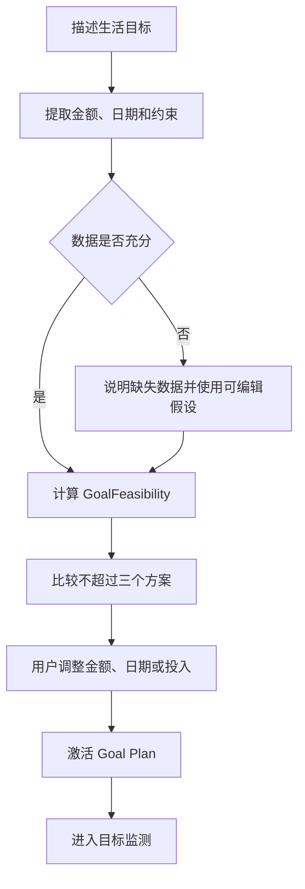
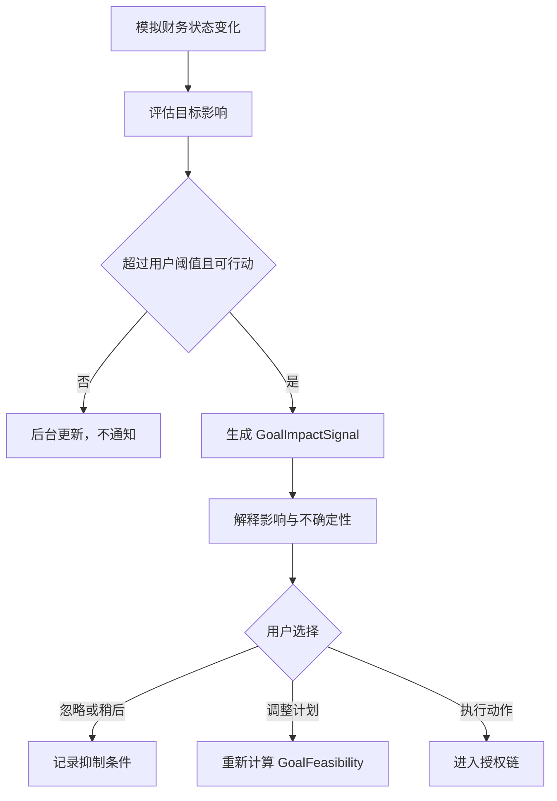

# NOVA — 目标驱动的主动式 AI 财务副驾驶

> 产品名称：**NOVA — Goal-driven AI Financial Copilot**
> 用户承诺：**不记账，也有数。**
> 团队名称：**NOVA FinTech Lab**
> 版本：v0.6（Money Mission 连续任务）
> 更新时间：2026-10-27
> 产品形态：移动端优先的响应式 Web / PWA
> 文档状态：MVP 产品基线（定位重置）

---

## 0. 文档使用说明

本文件是 NOVA MVP 的产品事实唯一来源（Single Source of Truth），用于统一产品、UX/UI、前端、后端、Agent、测试和比赛演示工作。

- 本文优先定义消费者价值，再定义支撑该价值的比赛技术能力。
- 标注为**方向性支持**的内容来自当前用户访谈，可用于收敛 MVP，但不代表市场规模或付费意愿已经验证。
- 标注为**存在分歧**或**待验证**的内容不得直接升级为默认功能。
- 所有真实资金、真实投资和真实银行连接均不属于 v0.2 Demo；Demo 数据与执行必须明确标注为模拟。
- 如果原型、Figma、代码、Notion 任务或旧版本文档与本文冲突，以本文为准；随后再同步其他系统。
- `Financial Twin`、`Generative UI`、`Permission Engine`、`Banking-as-Tools / MCP` 是内部能力或比赛证明，不是面向用户的首要定位。

---

## 1. 产品概述

### 1.1 一句话定义

NOVA 是一款**目标驱动的主动式 AI 财务副驾驶**：它在用户授权的数据范围内理解现金流，预测旅行、学费、开店等生活目标能否按时实现，并只在变化真正影响目标时给出可解释、可调整的行动建议。

### 1.2 用户承诺

> **不记账，也有数。**

NOVA 不要求用户每天分类流水、研究图表或在多个金融 App 之间来回核对。用户只需要说明目标、期限和不能触碰的资金，NOVA 负责：

1. 理解当前可用的财务数据。
2. 判断目标是否可行，并坦诚说明数据是否充分。
3. 给出不超过三个可比较的调整方案。
4. 持续观察真正影响目标的变化。
5. 只在重要、可行动且可解释时提醒用户。
6. 在用户明确确认或设置授权边界后，安全执行模拟金融操作。

### 1.3 定位陈述

面向拥有多个金融账户、讨厌记账，但正在为旅行、学费、应急金、开店或大额消费做准备的年轻用户，NOVA 将分散的财务数据转化为持续更新的目标计划，让用户随时知道：

- 我现在是否负担得起？
- 按当前节奏能否按时完成？
- 哪个变化真的会影响目标？
- 最少需要调整什么？
- 哪些动作必须由我确认？

### 1.4 双轨产品结构

| 轨道 | 目的 | 面向对象 | 在产品中的优先级 |
| --- | --- | --- | --- |
| Consumer Value Track | 解决目标可行性、计划调整与持续推进问题 | 普通个人用户 | 首要定位、首页叙事和前两条 Hero Experience |
| Competition Capability Track | 证明自然语言规划、Generative UI、受控自主执行与 Banking-as-Tools | 比赛评委、技术合作方 | 第三条 Hero Experience 和底层架构证明 |

两条轨道共享同一套 Goal、Permission、Risk、Tool Result 与 Audit 数据，但不能争夺同一个首要用户叙事。用户首先理解“目标能否实现”，之后才接触自主执行和平台能力。

### 1.5 核心产品链路

`创建生活目标 → 理解授权数据 → 判断可行性 → 比较方案 → 激活计划 → 监测目标影响 → 建议调整 → 经授权执行 → 验证与记录`

v0.6 把这条链路收成首页可进入的 **日本旅行 Money Mission**：目标 → 合成数据 → 账单摘要与证据 → 订阅处理 → 三方案 → 工资到账触发转入 → 监测与交接。首页消费数字和阶段只消费服务端读模型，不在页面重算。演示控制与生产界面分离。

### 1.6 与比赛要求的对应关系

目前已知的比赛要求包括：

- 通过自然语言理解金融意图。
- 自主规划并执行银行操作。
- 至少覆盖三个核心场景。
- 支持 App 和/或 IM 式交互。

NOVA 通过三条 Hero Experience 覆盖这些能力，但消费者首页不以“自主转账”作为默认价值承诺。比赛正式名称、主办方、截止时间、提交格式和评审权重仍需以官方材料核实。

---

## 2. 用户、问题与研究证据

### 2.1 目标用户

**MVP 目标用户：**熟悉数字产品、拥有多个金融账户或支付渠道、不愿意持续手工记账，并且存在一个明确中短期资金目标的年轻职场人、自由职业者或即将进入职场的大学毕业生。

典型特征：

- 有固定收入、生活费或周期性资金流入。
- 同时使用银行账户、微信、支付宝或其他支付工具。
- 正在准备旅行、学费、应急金、开店或大额消费。
- 具备基础金融常识，但不想每天监控流水和预算。
- 愿意让 AI 分析和制定方案，但希望明确控制资金操作。

### 2.2 核心 Jobs to be Done

> 当我准备一笔重要支出时，在不用持续记账的情况下，帮我判断是否负担得起、能否按期实现，以及最少需要调整什么；只有在我明确确认或设定授权边界后，才帮助我完成相关金融动作。

### 2.3 最终痛点层级

1. **维护财务信息的成本过高**：账户、流水和目标分散在多个 App，手工输入或导入账单麻烦且容易遗漏。
2. **数据没有转化成目标判断**：用户能看到余额和流水，却很难回答旅行、学费或开店目标能否按时完成。
3. **建议缺少取舍和下一步**：很多产品展示图表或提示超支，但没有说明目标影响和最小调整动作。
4. **高频提醒会制造噪音**：小额波动如果不影响目标，用户不希望被频繁提醒。
5. **权限与隐私决定是否采用**：用户需要知道读取了什么、为什么需要、能否撤销，以及 AI 是否会擅自动钱。

### 2.4 用户研究证据状态

当前研究样本较小，约包含两位不同受访者，且部分提问采用选项或解释后再询问的方式。以下结论只能作为 MVP 收敛依据，不能作为代表性市场结论。

| 证据等级 | 结论 | 产品处理 |
| --- | --- | --- |
| 方向性支持 | 用户不愿持续记账或在多个 App 之间切换 | 数据连接与低维护成本列为 P0 |
| 方向性支持 | 旅行、学费、开店等具体目标比日常小额消费更值得规划 | Goal-first 成为主定位与第一条 Hero |
| 方向性支持 | 主动提醒有价值，但应按周或在显著偏差时触发 | 不默认每日提醒；允许用户设置阈值 |
| 方向性支持 | 用户偏好直接、完整的数据连接，但前提是来源可信、权限清晰 | Onboarding 必须先展示价值并解释权限 |
| 存在分歧 | 一位受访者偏好便利的自动执行，另一位明确认为普通用户最多接受建议 | 默认 `Recommend`；执行必须逐次确认或匹配 Mandate |
| 待验证 | “养成系私人管家”能否显著提升留存 | 作为语气与个性化原则，不作为核心卖点 |
| 待验证 | 投资、股票、保险和长期理财推荐 | 不进入 MVP 核心范围 |
| 待验证 | 购物或旅行平台集成能否带来留存 | 进入赛后 Backlog |
| 待验证 | 用户付费意愿与长期留存 | 后续通过原型和 Pilot 验证 |

### 2.5 不应从当前访谈得出的结论

- 不能声称用户普遍希望 AI 自动转账或自动投资。
- 不能把“每天主动提醒”当作已验证需求。
- 不能因为用户喜欢便利，就省略权限解释和逐次确认。
- 不能把平台集成或股票推荐提前作为 MVP 留存机制。
- 不能把“直接银行授权”本身作为产品定位；它只是实现低负担体验的一种数据路径。

---

## 3. 产品原则

### 3.1 目标优先，而不是账本优先

产品从用户想完成的生活目标出发，而不是从交易分类、账户列表或投资产品目录出发。

### 3.2 主动，但保持安静

只有当变化同时满足**重要、相关、可行动、可解释**时才主动打扰用户。普通波动留在后台，默认提供每周摘要而不是每日警报。

### 3.3 不制造虚假精确度

预测使用区间、假设和数据充分性说明。除非模型和数据支持，不得用“多花 ¥50 会精确推迟 8 天”一类过度确定的表达。

### 3.4 先解释，再建议，最后才执行

每条主动建议必须回答：

- 发生了什么？
- 影响哪个目标？
- 为什么现在值得关注？
- 如果不处理，可能发生什么？
- NOVA 建议调整什么？
- 依据和不确定性是什么？
- 是否涉及资金操作和授权？

### 3.5 风险越高，用户控制越强

读取和分析可自动完成；计划和建议是默认能力；资金移动只能逐次确认或由既有 Mandate 在原边界内授权。创建、扩大或延长 Mandate，以及任何投资变更，都必须由用户逐次明确确认；既有 Mandate 不能授权自身变更。

### 3.6 技术能力不应增加用户理解成本

用户不需要理解 Financial Twin、MCP、Schema 或 Agent Orchestration。技术概念只在比赛说明、开发文档和必要的信任解释中出现。

### 3.7 冷静、可信、不评判

视觉和文案应降低焦虑，强调选择与取舍，不用羞辱式超支提醒、交易终端式信息密度或无法解释的风险分数。

---

## 4. 产品目标、非目标与范围

### 4.1 MVP 产品目标

1. 用户在首次体验两分钟内创建一个生活目标并理解其可行性。
2. 用户无需手工维护完整账本，也能看到现金流对目标的影响。
3. 用户能比较不超过三个方案，并修改金额、日期、每月投入和受保护资金。
4. 产品只在目标状态发生显著变化时主动提醒，并说明触发原因。
5. 用户能够理解数据用途、建议依据和资金操作边界。
6. 默认权限为 `Recommend`；任何模拟资金写操作都经过 Permission 与 Risk 检查。
7. 三条 Hero Experience 使用同一套 Contracts、Fixtures 和状态逻辑完成稳定比赛演示。

### 4.2 v0.2 非目标

- 连接真实银行账户或转移真实资金。
- 要求用户每日记账或逐笔分类消费。
- 提供受监管的个性化投资建议。
- 建立全自动交易或投资系统。
- 覆盖所有国家、银行、支付平台和金融产品。
- 替代法律、税务或专业财务建议。
- 训练自有基础模型。
- 实现生产级 KYC、AML、托管和支付清算。

### 4.3 赛后 Backlog

- 真实开放银行或聚合账户连接。
- 股票、保险、基金组合和长期财富管理扩展。
- 购物、旅行和生活服务平台集成。
- 真实周期性储蓄和自动划转。
- 家庭或多人共享目标。
- 商业化、订阅与付费方案。

### 4.4 Demo 边界

所有余额、交易、目标预测、风险分数、汇率、工具调用和执行结果均使用明确标注的模拟数据。产品不得暗示真实授权、转账、支付或投资已经发生。

---

## 5. 三个 Hero Experience

### 5.1 Hero 1：Goal Readiness & Plan

#### 所属轨道

Consumer Value Track，第一主线。

#### 用户价值

用户用一句自然语言描述生活目标，NOVA 判断目标能否实现，说明关键假设，并生成可调整的计划。

#### 示例意图

> “我想准备一笔 ¥8,000 的日本旅行预算，不能动用应急金，最好三个月后出发。”

#### Agent 行为

1. 提取目标金额、日期、受保护资金和可调整范围。
2. 检查当前模拟现金流、固定支出、已有目标和数据充分性。
3. 生成 `GoalFeasibility`，明确区分事实、预测和假设。
4. 生成保守、平衡、加速三种以内的方案。
5. 展示每个方案对每月可支配金额、完成时间和其他目标的影响。
6. 允许用户修改目标金额、日期、每月投入和安全线。
7. 激活 Goal Plan；默认不创建自动资金 Mandate。

#### 必需的 Generative UI

- `goal_input_card`
- `goal_feasibility_card`
- `goal_progress_card`
- `assumption_editor`
- `what_if_simulator`
- `scenario_compare`
- `plan_steps`
- `impact_summary`

#### 成功标准

用户在两分钟内从一句自然语言需求进入已激活的目标计划，并能准确说明为什么当前方案可行或不可行。

### 5.2 Hero 2：Goal Impact Monitoring

#### 所属轨道

Consumer Value Track，持续价值主线。

#### 用户价值

NOVA 在后台观察模拟现金流，只在变化会显著影响已激活目标时提醒用户，并提出最小必要调整。

#### 两种触达方式

1. **计划性周摘要**：用户启用后每周生成一次。没有显著变化时只说明目标仍处于原状态，不使用紧急文案，也不提供强制行动 CTA。
2. **事件型提醒**：仅在以下任一条件成立时触发：
   - 预计完成日期超出用户允许范围。
   - 目标完成概率或安全缓冲显著下降。
   - 单笔或累计变化超过用户设置的金额阈值。
   - 变化占目标剩余金额的比例超过用户设置的占比阈值。
   - 目标之间出现资金冲突。

#### 不应触发事件型提醒

- 不影响目标完成时间的小额波动。
- 用户已忽略且底层状态没有实质变化的同类建议。
- 缺乏足够数据、无法给出可靠影响判断的变化；此时只提示数据不足。

#### Agent 行为

1. 周摘要汇总当前 `GoalFeasibility` 和本周有效变化；无显著变化时明确说明“仍按计划推进”。
2. 事件型提醒生成 `GoalImpactSignal`。
3. 说明证据、目标影响、时间范围和不确定性。
4. 提供忽略、稍后处理、调整计划或查看原因。
5. 用户选择调整后，重新计算 `GoalFeasibility`。
6. 用户忽略后，记录抑制条件，避免重复骚扰。

#### MVP 目标感知策略

- NOVA 自动读取和整理模拟流水，用户不需要逐笔记账或手工分类。
- 当前 30 天与前两个 30 天窗口均值比较；同类至少 3 笔、增长至少 25%、绝对增加至少 ¥200 才形成趋势证据。
- 默认参考线为 ¥500 或目标剩余金额的 5%。只有目标状态越界、预计日期超出允许范围或安全资金受影响时才即时提醒；其余合格趋势进入周摘要。
- 历史不足两个月、数据过期或分类不确定时，不生成即时风险结论。
- 固定演示为：外卖与打车由过去两个月平均 ¥600 增至本期 ¥1,900，使日本旅行预计延期约 16 天后，自动创建风险会话。
- 用户自己的消费只能监测和建议，不声称真实拦截。只有 NOVA 或外部 Agent 经过 Banking Tools 发起的操作，才适用 Execute、Ask、Manual Review 或 Block。
- 风险会话只解释形成趋势的流水、目标和应急金影响，以及降低未来可选支出、增加目标投入、调整目标日期三个方向；不增加分类饼图、消费评分或评判式文案。

#### 必需的 Generative UI

- `goal_impact_brief`
- `goal_impact_signal`
- `cashflow_timeline`
- `goal_progress_card`
- `impact_summary`
- `scenario_compare`
- `notification_preference_card`

#### 成功标准

用户能在 30 秒内理解“发生了什么、为什么影响目标、是否需要处理”，并且不会将普通波动误认为紧急风险。

### 5.3 Hero 3：Permissioned Action & Banking-as-Tools

#### 所属轨道

Competition Capability Track，高级能力与技术证明。

#### 用户价值

用户可以在明确金额、类别、时间和频率边界后，让 NOVA 执行低风险模拟操作；不满足边界的请求必须 Ask 或 Block。

#### Demo 触发条件

用户先明确确认创建一个限定类别、金额、时间和有效期的模拟 Mandate；随后外部 Travel Agent 为日本旅行发起三笔结构化模拟支付请求：

1. 符合 Mandate 的小额交通请求 → `Execute`。
2. 购物请求要求逐次确认 → `Ask`。
3. 超过额度或身份无法验证 → `Block`。

#### Agent 行为

1. 读取结构化请求和当前 Goal 状态。
2. 验证请求方、商户、类别、金额、时间和用途。
3. 检查 Mandate、剩余预算、Permission 和 Risk。
4. 返回 `Execute`、`Ask` 或 `Block`。
5. 只有全部硬规则通过时才调用模拟 Banking Tool。
6. 验证 Tool Result，更新 Goal，并写入 Audit。

#### 必需的 Generative UI

- `external_agent_request`
- `mandate_match`
- `approval_sheet`
- `risk_disclosure`
- `execution_receipt`
- `error_recovery`

#### 成功标准

用户和评委能理解为什么一笔请求被执行、另一笔需要确认、第三笔被阻断，并可查看完整记录。

---

## 6. 核心用户旅程

### 6.1 创建并激活目标



### 6.2 监测并调整目标



### 6.3 安全执行链

`Agent Plan → Permission → Risk → Execute → Verify → Audit`

任何写操作都不能跳过该顺序。模型输出、UI 动画或用户口头同意均不能替代结构化 Permission 和 Tool Result。

---

## 7. 信息架构

### 7.1 主导航

| 入口 | 用户任务 |
| --- | --- |
| Home | 查看最重要目标、目标状态和当前唯一优先行动 |
| Goals | 创建、查看和调整所有生活目标与计划 |
| Agent | 用自然语言提出问题，并在受治理画布中完成复杂任务 |
| Activity | 查看建议、计划调整、授权、执行凭证和 Audit 历史 |
| Profile | 管理模拟账户、提醒偏好、隐私、权限和 Demo 设置 |

`Financial Twin` 不作为面向用户的导航名称。相关信息按用户任务分别进入 Home、Goals、Activity 和 Profile。

### 7.2 全局控件

- 隐藏金融数值的隐私模式。
- 模拟数据与 Demo Mode 标识。
- 全局 `Ask NOVA` 入口。
- 数据更新时间与数据不足提示。
- 通知偏好快捷入口。

### 7.3 P0 页面与状态

1. Value Preview 与 Onboarding
2. Create Goal
3. Goal Readiness / Feasibility
4. What-if Simulator 与 Scenario Compare
5. Goal Dashboard
6. Home / Goal Impact Brief
7. Goal Impact Detail
8. Agent Workspace + Governed Canvas
9. Notification Preferences
10. Connected Simulated Accounts
11. Create Mandate
12. External Agent Request
13. Execute / Ask / Block
14. Approval Sheet
15. Execution Receipt
16. Activity 与 Audit Detail
17. Loading、Empty、Insufficient Data、Failure、Offline 与 Recovery 状态
18. Mandate 基础控制：查看、暂停与撤销

### 7.4 P1 页面

- 完整的多目标优先级管理页面；P0 仍必须检测资金过度分配、阻断冲突方案并提供最小优先级选择。
- 高级 Mandate Management：多规则比较、编辑历史和批量管理。
- 目标归档与新目标引导。
- 详细数据来源与解释中心。
- 风险偏好与 Disclosures。

---

## 8. Onboarding 与权限

### 8.1 Onboarding 顺序

1. **展示价值**：用模拟案例说明 NOVA 如何判断一个目标能否实现。
2. **创建目标**：填写目标金额、日期、优先级和不可触碰资金。
3. **连接模拟数据**：说明读取的数据范围、用途和可撤销性。
4. **设置提醒**：选择每周摘要、金额阈值、目标占比阈值和暂停选项。
5. **确认默认权限**：默认选择 `Recommend`，不要求用户预先授权自动执行。

### 8.2 权限等级

| 等级 | 含义 | MVP 默认行为 |
| --- | --- | --- |
| Observe | 读取、汇总和解释模拟数据 | 自动完成 |
| Recommend | 生成可行性、计划和调整建议 | **默认等级** |
| Confirm to execute | 用户对每次准确操作明确确认后执行 | 所有未匹配 Mandate 的写操作 |
| Mandated autonomy | 在明确类别、金额、时间、频率和有效期内执行 | 仅 Hero 3 Demo 使用 |

### 8.3 权限体验要求

- 权限文案必须描述具体数据或动作，不能只写“允许 AI 管理财务”。
- 不得默认勾选同意。
- 用户必须能查看、暂停和撤销 Mandate。
- 金额、账户、时间、产品或费用发生实质变化后，原 Approval 立即失效。
- 数据读取权限和资金执行权限必须分开表达。

---

## 9. 详细功能需求

### 9.1 Goal

每个 Goal 包含：

- 名称、类型与可选封面。
- 目标金额、币种和日期。
- 已积累金额与计划每月投入。
- 资金来源和受保护资金。
- 优先级和可调整范围。
- 状态：`draft`、`active`、`paused`、`achieved`、`archived`。

功能要求：

- 支持自然语言和结构化表单创建。
- 同时最多比较三个方案。
- 显示对 Safe-to-spend、其他目标和安全缓冲的影响。
- 达成目标后引导用户归档、维持储蓄习惯或创建新目标，但不得强迫继续使用。

### 9.2 GoalFeasibility

`GoalFeasibility` 是对目标可行性的结构化判断，至少包含：

- `status`：`insufficient_data`、`on_track`、`at_risk`、`infeasible`。
- `projectedCompletionDate`：预计完成时间或时间区间。
- `requiredContribution`：建议周期投入。
- `availableAdjustmentRange`：可调整金额、日期或投入范围。
- `protectedFundsImpact`：是否触及受保护资金。
- `safeToSpendImpact`：计划对可支配资金的影响。
- `assumptions`：计算使用的可编辑假设。
- `evidence`：支持结论的数据摘要。
- `dataSufficiency`：数据覆盖与主要缺口。
- `updatedAt`：判断生成时间。

要求：

- `insufficient_data` 时不得伪造完成日期。
- `infeasible` 时必须说明冲突并给出最小必要修改。
- 预测必须展示区间或假设，不能表现为保证。
- 用户修改方案后必须重新计算并标明更新时间。

### 9.3 What-if 与方案比较

- 用户可修改目标金额、日期、每月投入、安全线和受保护资金。
- 最多展示三个命名明确的方案，例如保守、平衡、加速。
- 每个方案展示完成时间、周期投入、可支配金额和主要代价。
- 不得把推荐方案预选为不可更改的唯一答案。

### 9.4 GoalImpactSignal

`GoalImpactSignal` 只表示对某个目标有实际意义的事件变化，不用于表示计划性周摘要，至少包含：

- `goalId`
- `signalType`
- `detectedAt`
- `evidence`
- `estimatedImpact`
- `impactRatio`
- `urgency`
- `confidence`
- `recommendedAction`
- `expiryCondition`
- `suppressionState`

事件型提醒必须同时满足；本节是唯一的提醒资格判断规则：

1. 与活跃目标直接相关。
2. 超过已配置的金额/占比阈值，或显著改变目标状态。
3. 有明确、可理解的下一步。
4. 证据足够支持影响判断。

### 9.5 NotificationPreferences / RiskPreferences

至少支持：

- `weeklySummaryEnabled`
- `amountThreshold`
- `goalImpactRatioThreshold`
- `quietHours`
- `pausedUntil`
- 按 Goal 单独覆盖提醒设置。

默认值：启用每周应用内摘要；关闭每日摘要。没有显著变化的周摘要只报告目标仍按计划推进，不使用紧急通知；事件型提醒仅按 9.4 的资格规则触发。普通小额变化不推送；高风险执行和授权失效不受营销型静默设置影响。

MVP 代码中的 `RiskPreferences` 是上述产品偏好的可执行子集，金额使用整数分、目标占比使用 basis points，并保存规则版本、Twin Version 和抑制状态以支持可复现审计。

### 9.6 数据连接与信任

- MVP 只连接模拟账户和确定性 Fixtures。
- 首版来源为模拟银行卡、微信支付和支付宝；默认全选，也可逐项关闭。
- 创建目标后如尚未连接，必须先完成独立连接步骤，之后才给出基于流水的可行性结论；已有连接直接复用。
- 连接仅授权读取余额和近 90 天流水，不授权扣款、转账，也不读取联系人、聊天或位置。
- 首次连接立即导入历史；打开应用、回到前台及应用保持打开期间每分钟幂等检查一次。应用关闭期间不运行任务，下次打开时补齐遗漏批次。
- UI 必须明确标注数据为模拟数据。
- “我的”提供来源状态、覆盖范围、最近更新时间与撤销入口。撤销停止未来同步但保留历史判断和审计；重新连接只补齐缺失批次。
- 数据不足、来源缺失或超过七天未更新时，不生成确定性的即时风险结论。
- 设计上预留未来真实数据授权与账单导入，但不得暗示已实现。
- 展示数据读取范围、最近更新时间、缺失账户和撤销入口。
- 分析结果必须区分客观数据、系统预测和用户假设。

### 9.7 Agent Workspace

Agent Workspace 包含：

- 用于意图、解释和澄清的对话区。
- 用于结构化 Goal UI 的 Governed Canvas。
- 当前计划步骤和状态。
- 可编辑假设。
- 推荐问题和输入入口。

澄清规则：只有缺失信息会实质影响安全、可行性或真实意图时才追问；其他情况使用可见且可编辑的假设。

### 9.8 Approval Sheet

Approval Sheet 必须展示：

- 将要执行的准确操作。
- 模拟资金来源与去向。
- 金额、币种、费用和时间。
- 影响的 Goal 与剩余预算。
- NOVA 推荐该动作的原因。
- 主要风险、代价和使用的 Permission / Mandate。
- 明确的确认和取消操作。

按钮必须写出准确动作，例如“确认模拟转账 ¥1,500”，不能只写“继续”。

### 9.9 Activity 与 Audit

- 按时间展示建议、计划调整、授权、执行、失败、取消和撤销。
- 每条记录包含触发原因、输入参数、Permission、Risk、Tool Result 与最终状态。
- Tool Result 是 Execution Receipt 的唯一事实来源。
- 只有不存在重复执行风险时才允许重试。

### 9.10 External Agent Request

该能力仅服务 Competition Capability Track。必须展示：

- 请求 Agent 及验证状态。
- 商户、金额、类别、用途和时间。
- 对当前 Goal 和类别预算的影响。
- 匹配的 Mandate、Permission 与 Risk 结果。
- `Execute`、`Ask` 或 `Block` 及普通语言解释。

---

## 10. 内部状态模型

### 10.1 Financial Twin 的定位

`Financial Twin` 保留为内部状态层，不作为用户导航或核心卖点。它负责为 Goal 判断、Signal、计划、授权和执行提供一致数据。

组成：

- **Financial State**：模拟账户、余额、交易、账单、订阅、资产和负债。
- **Goals**：金额、日期、优先级、约束、计划和进度。
- **Life Context**：旅行、生活事件、偏好和外部请求。
- **Permissions**：读取范围、逐次确认和 Mandate。

### 10.2 核心实体

| 实体 | 关键职责 |
| --- | --- |
| User | Locale、基础币种、隐私和风险偏好 |
| Account / Transaction / Bill | 提供模拟财务事实 |
| Goal | 保存目标、约束和生命周期状态 |
| GoalFeasibility | 保存可行性、预测、假设和数据充分性 |
| GoalPlan | 保存方案、周期投入和步骤状态 |
| GoalImpactSignal | 保存目标相关变化、影响和建议 |
| NotificationPreferences | 保存摘要、阈值、静默和暂停设置 |
| FinancialTwin | 汇总内部财务状态、目标、上下文和权限 |
| Plan | 保存 Agent 计划和步骤状态 |
| Mandate | 保存类别、金额、时间、频率和有效期边界 |
| Approval | 保存不可变操作参数快照 |
| AgentRequest | 保存外部 Agent 的结构化请求 |
| ToolOperation | 保存工具参数、幂等键和结果 |
| AuditEvent | 保存不可变事件记录 |

### 10.3 状态分层

- 客观事实来自 Fixtures 或 Tool Result。
- 预测和建议来自确定性引擎；LLM 只能帮助解析意图和生成用户可读解释。
- 用户假设必须可见、可编辑，不得悄悄写回客观财务事实。
- UI 只能消费通过 Zod 校验的状态和 Generated UI Schema。

---

## 11. Generative UI 与共享 Contracts

### 11.1 组件白名单

| 组件 | 用途 |
| --- | --- |
| `goal_input_card` | 收集目标金额、日期和约束 |
| `goal_feasibility_card` | 展示可行性、数据充分性和预测区间 |
| `goal_progress_card` | 展示目标进度与下一步 |
| `assumption_editor` | 查看和修改计算假设 |
| `what_if_simulator` | 调整金额、日期、投入和安全线 |
| `scenario_compare` | 比较最多三个方案 |
| `goal_impact_brief` | 汇总本周真正重要的目标变化 |
| `goal_impact_signal` | 解释单个变化、影响和建议 |
| `cashflow_timeline` | 展示与目标有关的预计现金流 |
| `impact_summary` | 展示行动前后对目标的影响 |
| `plan_steps` | 展示计划步骤和状态 |
| `notification_preference_card` | 设置摘要和阈值 |
| `external_agent_request` | 展示结构化外部请求 |
| `mandate_match` | 解释请求和授权规则匹配 |
| `approval_sheet` | 获得明确授权 |
| `risk_disclosure` | 解释风险和限制 |
| `execution_receipt` | 展示 Tool Result 与 Audit |
| `error_recovery` | 解释失败并提供安全下一步 |

### 11.2 Schema 规则

- 每个组件包含稳定的 `id`、`type`、`title`、`data` 和 `actions`。
- 金额使用结构化 `amount` 与 `currency`，不能只有格式化文本。
- 每个 action 声明风险类别、是否需要授权和影响的 Goal。
- 前端在渲染前校验 Schema。
- 未知组件或无效 Schema 降级为安全解释卡。
- UI Component 不得直接调用 Banking Tool。
- 组件内不得硬编码与 Fixtures 冲突的金额或状态。

### 11.3 示例

```json
{
  "id": "goal-feasibility-japan-001",
  "type": "goal_feasibility_card",
  "title": "按当前计划，旅行目标处于可实现范围",
  "data": {
    "goalId": "goal_japan_trip",
    "status": "on_track",
    "target": { "amount": 8000, "currency": "CNY" },
    "projectedCompletionDate": "2026-12-15",
    "requiredContribution": { "amount": 1500, "currency": "CNY", "cycle": "monthly" },
    "dataSufficiency": "sufficient",
    "assumptions": ["未来三个月固定收入保持不变"]
  },
  "actions": [
    {
      "intent": "open_what_if_simulator",
      "label": "调整计划",
      "riskClass": "analysis",
      "requiresApproval": false,
      "goalId": "goal_japan_trip"
    }
  ]
}
```

---

## 12. Agent 行为规范

### 12.1 Agent Loop

1. **Observe**：读取与当前 Goal 相关的模拟财务事实。
2. **Interpret**：解析目标、约束或变化。
3. **Assess**：由确定性引擎计算 GoalFeasibility 或 Goal Impact。
4. **Plan**：生成可编辑的方案和步骤。
5. **Render**：选择受治理组件。
6. **Authorize**：检查 Permission 或 Mandate。
7. **Assess Risk**：校验余额、额度、时效、重复调用和冲突。
8. **Execute**：调用白名单模拟 Banking Tool。
9. **Verify**：检查 Tool Result 和更新后的状态。
10. **Audit**：写入不可变事件并展示凭证。
11. **Recover**：失败时解释当前状态并给出安全下一步。

### 12.2 模型与确定性边界

- DeepSeek 负责自然语言意图解析、解释和文案草拟。
- 确定性引擎负责 GoalFeasibility、阈值、Permission、Risk 和执行决策。
- DeepSeek 不得直接改变余额、Goal 状态、Mandate 或 Tool Result。
- 必须同时提供 `DeepSeekAgentProvider` 和 `DeterministicAgentProvider`。
- DeepSeek 不可用时，无需修改 Fixtures 即可完成全部 Demo。

### 12.3 主动信号策略

事件型提醒先严格应用 9.4 的四项资格规则。金额阈值和目标占比阈值是布尔门槛，不参与乘法评分，也不能因数值变大而提高通知概率。

当多个合格 Signal 同时存在时，再按影响程度、紧急度和数据置信度排序；不合格变化只更新后台状态。计划性周摘要独立生成，不进入事件型提醒排序。

### 12.4 Memory

短期 Session Memory：

- 当前 Goal 和意图。
- 已选方案和可编辑假设。
- 待处理计划、授权和错误状态。

长期 Preference Memory：

- Goals 与优先级。
- Safety Buffer。
- 通知阈值和静默偏好。
- 风险舒适度和解释深度。
- 用户明确创建的 Mandate。

普通对话偏好不得自动升级为金融 Mandate。

### 12.5 Guardrails

- Tool Allow-list 与强类型参数。
- 每次写操作前进行 Permission Check。
- 执行前进行 Risk 与 Balance Check。
- 工具调用使用 Idempotency Key。
- 授权按时间和范围失效。
- 明确区分事实、预测、建议和模拟结果。
- 不使用“保证完成”“保证收益”等承诺。
- 数据不足或冲突时安全降级。
- 每个计划和执行状态变化写入 Audit Event。

---

## 13. Banking-as-Tools / MCP

### 13.1 产品作用

Banking-as-Tools 是 Competition Capability Track 的底层能力。面向个人用户的 NOVA App 是首个客户端；用户无需理解 MCP 或工具名称。

### 13.2 MVP Tools

| Tool | 类型 | 授权要求 |
| --- | --- | --- |
| `get_accounts` | 读取 | Observe |
| `get_transactions` | 读取 | Observe |
| `get_upcoming_bills` | 读取 | Observe |
| `forecast_cashflow` | 分析 | Recommend |
| `assess_goal_feasibility` | 分析 | Recommend |
| `create_goal` | 写入应用状态 | 明确确认 |
| `update_goal` | 写入应用状态 | 实质变化时确认 |
| `prepare_goal_adjustment` | 计划 | Recommend |
| `prepare_internal_transfer` | 计划 | Recommend |
| `execute_internal_transfer` | 模拟资金操作 | 逐次确认或匹配 Mandate |
| `create_recurring_mandate` | Mandate | 始终确认 |
| `pause_mandate` | Mandate | 确认 |
| `evaluate_external_agent_request` | Permission / Risk | 由硬规则决定下一状态 |
| `execute_external_payment` | 模拟资金操作 | 匹配 Mandate 或明确确认 |
| `get_activity` | 读取 | Observe |

### 13.3 Tool Response

每个写 Tool 返回：

- `operationId`
- `status`
- `timestamp`
- `requestedParameters`
- `executedParameters`
- `goalImpact`
- `fees`
- `failureCode` 与 `failureMessage`
- `reversible`
- `nextSafeAction`

### 13.4 Mock-first

MVP 使用确定性 Scenario Fixtures 和模拟 Banking Tools。Scenario Switch 必须能够重置同一状态，并稳定复现成功、余额不足、授权失效、数据过期、Timeout 和重复调用。

---

## 14. UX Writing

### 14.1 语气

- 冷静。
- 直接。
- 具体。
- 不评判。
- 坦诚表达不确定性。
- 优先说明目标影响，而不是批评单笔消费。

### 14.2 推荐表达

| 避免 | 推荐 |
| --- | --- |
| “你这周严重超支。” | “本周可选支出增加，但目前仍不影响旅行目标。” |
| “多花 ¥50 会让旅行推迟 8 天。” | “如果近期支出保持当前水平，旅行目标的完成时间可能晚于原计划。” |
| “你的财务状况有风险。” | “按当前计划，12 月的旅行目标可能少 ¥600。” |
| “AI 建议优化预算。” | “每月多存 ¥200，或将出发日期延后两周，都能恢复到可实现范围。” |
| “已完成。” | “模拟转账已完成，旅行目标进度已更新。” |
| “出现错误。” | “模拟账户余额已变化，本次操作未执行。请查看更新后的方案。” |

### 14.3 不确定性表达

- 使用“预计”“可能”“基于当前数据”等限定。
- 展示数据更新时间和关键假设。
- 数据不足时直接说明无法可靠判断。
- 预测变化应给出范围，不给出无法支撑的精确天数。

---

## 15. 视觉设计方向

### 15.1 设计意图

产品应呈现“冷静、可信、有生活目标温度”的金融体验。首屏优先展示目标状态和下一步，不做传统银行 Dashboard，也不做高频警报中心。

### 15.2 视觉层级

1. 当前最重要的 Goal 和状态。
2. 是否需要用户处理。
3. 目标进度、预测区间和关键假设。
4. 可比较方案与单一主 CTA。
5. 解释、数据来源和高级权限信息。

### 15.3 响应式规则

- 移动端优先。
- 桌面端可并排展示 Goal 上下文、对话和 What-if Canvas。
- Approval Sheet 在移动端使用 Bottom Sheet，在桌面端使用居中 Dialog。
- 图表在 360 px 宽度下可阅读，不依赖横向滚动。

### 15.4 无障碍与质量

- 文本和控件至少达到 WCAG AA。
- 触控区域不小于 44 × 44 px。
- 状态不能只依赖颜色。
- 主要流程支持键盘和 Reduced Motion。
- 金额和图表提供文本说明。
- 每个界面最多一个主 CTA。
- Loading、Empty、Insufficient Data、Success、Failure、Permission 和 Recovery 全部设计。
- 不使用泛化 AI Sparkle 作为主要品牌标识。

---

## 16. 技术实现基线

### 16.0 当前原型实现状态

- 手机端在对话消息中内联展示白名单组件；桌面端采用约 32% 对话区与 68% Governed Canvas。
- 目标假设支持只读 What-if 预览；只有服务端签发、绑定会话与 Twin Version 的 `actionId` 经用户确认后才写入。
- 每周风险摘要与即时 `GoalImpactSignal` 分开保存。摘要按亚洲上海时区周一至周日去重且不显示紧急红点；显著恶化仍进入即时风险会话。
- 通知偏好覆盖摘要开关、金额与目标占比阈值、暂停日期、静默时间和目标级覆盖。授权失效、保护资金和执行安全判断不受静默时间影响。
- 旧组件类型和既有 SQLite 数据继续兼容；未知或非法组件降级为无执行按钮的说明卡。

### 16.1 架构方向

- 移动端优先的 React + TypeScript + Vite Web / PWA。
- Node.js TypeScript API 与共享 Zod Contracts。
- Goal-first 前台与内部 Financial Twin 状态层。
- Governed Generative UI Renderer。
- Permission Engine 与 Risk Engine 独立于 LLM。
- Banking-as-Tools / MCP 只暴露白名单模拟工具。
- 确定性 Demo Mode 与 DeepSeek Mode 使用相同输出契约。

### 16.2 模块边界

- **Web App**：页面、交互、可访问性和受治理组件。
- **API**：Agent 请求、Goal 操作和 Tool 调用边界。
- **Domain Engine**：GoalFeasibility、Signal、Permission、Risk 和状态机。
- **Contracts**：共享 Zod Schema 与枚举。
- **Scenario Fixtures**：集中、可重置的模拟数据。
- **Agent Providers**：DeepSeek 与 Deterministic 实现。
- **Tool Executor**：模拟银行工具、Verify 和 Audit。

### 16.3 技术栈

- 前端：React + TypeScript + Vite。
- 样式：Tailwind CSS + Design Tokens。
- 无障碍组件：Radix UI 或同类方案。
- 状态管理：Zustand 或 React Context，最终选择由 Architecture Owner 记录。
- 图表：Recharts 或 Visx。
- 动效：Framer Motion。
- Schema：Zod。
- API：Node.js TypeScript Service。
- 测试：Vitest + React Testing Library + Playwright。

### 16.4 前端边界

- React 组件不能直接调用 Banking Tool。
- Schema 校验通过后才能进入应用状态。
- Approval 使用不可变参数快照。
- Tool Result 是 Receipt 唯一事实来源。
- Fixtures 集中管理，组件不得维护独立金额副本。
- UI 只显示当前 Goal 需要的 Financial Twin 投影，不暴露完整内部模型。

---

## 17. 数据指标与成功标准

### 17.1 North-star Behavior

> **用户建立一个真实生活目标后，能够持续理解其状态，并采纳至少一次有帮助、可控的计划调整。**

Prototype 阶段以任务理解、建议采纳和信任表现验证，不追求生产规模指标。

### 17.2 Pilot 指标

| 类别 | 指标 |
| --- | --- |
| Activation | 首次 Session 中创建 Goal 并看到 GoalFeasibility 的比例 |
| Goal Value | 激活 Goal Plan 的比例 |
| Comprehension | 用户能正确复述目标状态、主要假设和下一步的比例 |
| Proactive Value | GoalImpactSignal 的查看、采纳、忽略和稍后处理比例 |
| Actionability | 从建议进入计划调整或确认行动的比例 |
| Trust | 权限理解度、取消率、Mandate 修改率和解释查看率 |
| Goal Continuity | 用户按周查看 Goal 或处理有效 Signal 的比例 |
| Reliability | Tool 成功率、重复执行拦截率和恢复成功率 |

### 17.3 核心 Analytics Events

- `goal_creation_started`
- `goal_created`
- `goal_feasibility_viewed`
- `goal_assumption_edited`
- `goal_scenario_compared`
- `goal_plan_activated`
- `goal_impact_signal_created`
- `goal_impact_signal_viewed`
- `goal_impact_signal_dismissed`
- `goal_impact_signal_snoozed`
- `goal_adjustment_accepted`
- `notification_preference_changed`
- `permission_level_selected`
- `approval_viewed`
- `approval_confirmed`
- `approval_cancelled`
- `mandate_created`
- `external_agent_request_received`
- `permission_decision_made`
- `tool_execution_started`
- `tool_execution_succeeded`
- `tool_execution_failed`
- `receipt_viewed`

不得记录完整账号、原始敏感金融文本、密钥或模型隐藏推理。

### 17.4 Demo 成功标准

- 三个 Hero Experience 均可端到端完成。
- Goal 创建和可行性判断是第一条完整主线。
- 至少一个 GoalImpactSignal 无需用户 Prompt，由显著变化触发。
- 普通小额变化不会触发通知。
- 至少一个 Plan 调用两个或以上模拟 Tools。
- 每个写操作通过 Permission 与 Risk。
- Success、Failure、Cancellation、Timeout 和 Recovery 可演示。
- 移动端和桌面端使用同一 Contracts 与 Fixtures。

---

## 18. 边缘情况与失败处理

| 情况 | 必需行为 |
| --- | --- |
| Goal 数据不足 | 状态为 `insufficient_data`，说明缺口，不生成虚假日期 |
| Goal 正常 | 显示 `on_track`，不制造无必要警报 |
| Goal 显著偏离 | 生成可解释的 `GoalImpactSignal` 和最小调整方案 |
| Goal 无法满足 | 状态为 `infeasible`，说明冲突并提供金额、日期或投入调整 |
| 用户忽略建议 | 记录抑制条件；底层状态无实质变化前不重复提醒 |
| 用户修改计划 | 重新计算可行性，展示新旧影响和更新时间 |
| Goals 冲突 | P0 检测并阻断过度分配，展示最小优先级选择；完整管理页面属于 P1 |
| 余额不足 | 停止执行，重新计算 Goal 影响 |
| 数据过期 | 标记更新时间；授权前刷新或阻断 |
| 重复操作请求 | 使用 Idempotency Key 并展示已有 Operation |
| Tool Timeout | 显示“状态未知”，Verify 后才允许重试 |
| 用户修改已授权参数 | 旧 Approval 失效，生成新 Snapshot |
| Generated UI Schema 无效 | 降级为安全解释卡并记录错误 |
| External Agent 无法验证 | `Block`，不得执行 |
| Mandate 过期或额度用完 | `Ask` 或 `Block`，说明具体规则 |
| 执行失败 | 不更新为完成；保留可恢复状态和下一安全动作 |
| Offline / Service Unavailable | 保留 Draft Plan，禁止执行，允许确定性本地 Demo |

---

## 19. Demo Narrative

### 19.1 三分钟故事

1. **从目标开始**：用户说“我想三个月后去日本，预算 ¥8,000，不能动应急金”。
2. **判断可行性**：NOVA 读取模拟现金流，展示 GoalFeasibility、关键假设和三种以内方案。
3. **激活计划**：用户调整每月投入并激活平衡方案，默认不授权自动转账。
4. **出现有意义的变化**：模拟一笔或一组足以影响目标的支出，NOVA 生成 GoalImpactSignal；普通小额变化留在后台。
5. **调整计划**：用户比较“每月多存一点”和“延后两周”，选择其中一个。
6. **展示受控执行**：用户确认一次模拟内部转账，看到 Permission、Risk、Verify 和 Receipt。
7. **证明 Banking-as-Tools**：用户先明确确认创建限定范围的模拟 Mandate；Travel Agent 随后发起三笔请求，稳定展示 Execute、Ask、Block。
8. **以 Audit 收尾**：所有判断、授权、工具结果和 Goal 更新可追溯。

### 19.2 Demo 必须证明

- Goal-first，而不是传统账本或银行 Dashboard。
- Proactive but quiet，而不是高频消费警察。
- Generative UI，而不是纯文字 Chatbot。
- 确定性 Goal 判断和多步骤计划，而不是 LLM 自由发挥。
- 默认建议、明确确认、有限 Mandate 的权限梯度。
- Consumer App 与 Banking-as-Tools 使用同一安全链路。

---

## 20. 交付顺序

具体日期、Owner 和状态由 Notion 维护；本节只定义依赖顺序。

### Phase 1：Positioning & Goal Flow Freeze

- 冻结目标用户、JTBD、Goal-first Demo Narrative。
- 完成 Goal Readiness、Goal Impact 和 Permissioned Action 三条 Flow。
- 冻结 Screen Inventory、状态矩阵和模拟 Persona。

### Phase 2：Design & Contract Freeze

- 完成视觉方向、Figma Design System Lite 和关键帧。
- 共同冻结 `Goal Flow × UI Component × Schema State` 映射。
- 定义 GoalFeasibility、GoalImpactSignal 和 NotificationPreferences Schema。

### Phase 3：Goal-first Vertical Slice

- 搭建 TypeScript Workspace 和集中 Fixtures。
- 实现 GoalFeasibility、What-if、Plan Activation 和 Goal Impact。
- 完成移动端与桌面端端到端流程。

### Phase 4：Permissioned Action & Competition Track

- 实现 Approval、Mandate、Execute / Ask / Block。
- 实现 Banking Tools、Verify、Audit、幂等和恢复。
- 完成 DeepSeek 与 Deterministic Provider 的同契约输出。

### Phase 5：Integration & Competition Polish

- 完成单元、集成和 Playwright E2E。
- 完成响应式、无障碍、视觉 QA 和安全检查。
- 冻结 Demo 数据、视频、截图、线上与本地备用路径。

### 20.1 Notion 路线图迁移提示

现有 Notion 路线图仍将 `Morning Brief` 作为第一条纵向切片，并包含已经过去或即将过期的旧里程碑日期。该路线图需要在本文件确认后单独更新：

- `Morning Brief` 相关任务改为 `Goal-first Vertical Slice`。
- 第一条切片从 Goal Readiness 跑到 Plan Activation，再由显著变化触发 GoalImpactSignal。
- External Agent 和 Mandate 保留，但排在 Goal 主线之后。
- 本次仅更新 `PRODUCT.md`，不直接修改 Notion。

---

## 21. 团队分工与开发交接

分工依据：[NOVA｜产品开发总控台](https://app.notion.com/p/3d50f6d2b04a819cb7b9f059b15e8d53)。

### 21.1 Design Owner

对以下内容负最终责任：

- 产品定位、功能范围和优先级。
- User Flow、信息架构、Screen Inventory 和 UX Writing。
- Figma Design System、交互原型和高保真关键帧。
- React 页面、受治理 UI 组件、响应式和动效实现。
- 可用性测试、视觉 QA、演示脚本、视频和截图。
- 验收 Architecture Owner 提供的数据和状态能否被普通用户理解。

### 21.2 Architecture Owner

对以下内容负最终责任：

- TypeScript Workspace、API 边界和共享 Zod Schema。
- 集中 Scenario Fixtures 和可重置 Demo State。
- GoalFeasibility、GoalImpact、Plan、Permission、Risk 和 Audit 状态机。
- DeepSeekAgentProvider、DeterministicAgentProvider 和模拟 Banking Tools。
- 幂等、Timeout、数据过期、失败恢复和安全降级。
- 单元、集成、Playwright E2E、CI、阿里云部署和本地备用环境。
- 验收 Design Owner 的交互是否覆盖全部系统状态和安全规则。

### 21.3 共享契约

- 每个任务有唯一 Owner；共同验收不等于共同维护同一文件。
- Schema 由 Architecture Owner 维护并记录变更；Design Owner 不在组件中私自扩展字段。
- Architecture Owner 新增状态时必须给出用户可见含义、进入条件、退出条件和失败行为。
- Design Owner 决定该状态的信息层级、文案、组件和交互。
- Fixtures 由 Architecture Owner 集中管理；Design Owner 只消费稳定 ID 和 Schema。
- 双方共同冻结 `Goal Flow × UI Component × Schema State` 映射后才能进入集成。
- 每项交付由另一位成员 Review 后进入 Done。

### 21.4 给 Architecture Owner 的核心提醒

> 这次调整不是删除 Agentic Banking，而是改变实现顺序和默认行为。第一条纵向切片应从 Goal Readiness 跑到 Plan Activation，再由显著财务变化触发 GoalImpactSignal。Morning Brief 不再是第一主线；自动执行不是默认权限；Financial Twin 保持内部状态模型。请优先调整 Contracts、Fixtures、State Matrix 和测试场景，不要先扩展投资、外部平台或高频提醒。

### 21.5 Architecture Owner 的近期交付重点

1. 将旧 `Signal` 契约收窄为 Goal 相关的 `GoalImpactSignal`。
2. 定义 `GoalFeasibility` 与 `NotificationPreferences` Zod Schema。
3. 将默认权限固定为 `Recommend`。
4. 重排 Fixtures，使第一条场景稳定覆盖：目标创建 → 可行性 → 方案 → 激活 → 显著偏差 → 调整。
5. 保留 Hero 3 的 Mandate 和 External Agent Fixtures，但不让其阻塞 Goal-first Slice。
6. 为数据不足、正常、偏离、不可行、忽略、调整、失败和恢复建立状态矩阵与测试。
7. 确保 DeepSeek 与 Deterministic Provider 返回同一结构，财务计算和权限判断不由 LLM 决定。

### 21.6 Design Owner 在交接前提供的输入

1. 三条更新后的 Hero User Flow。
2. Screen Inventory 与每屏主任务。
3. Goal 相关组件状态表。
4. 提醒阈值和权限文案。
5. 移动端与桌面端关键帧。
6. 正常、数据不足、偏离、失败和恢复状态的验收标准。

---

## 22. Definition of Done

满足以下条件才视为 MVP 完成：

- 新用户能用一句话解释 NOVA：帮助判断并推进生活目标，而不是自动记账或自动投资。
- 两分钟内完成目标创建、可行性理解和计划激活。
- GoalFeasibility 覆盖 `insufficient_data`、`on_track`、`at_risk` 和 `infeasible`。
- 事件型 Goal Impact 只在超过阈值或显著改变目标状态时提醒；启用周摘要后，即使没有显著变化也只发送平静的“仍按计划推进”状态。
- 用户能查看、修改和暂停通知阈值。
- 三个 Hero Experience 使用一致 Contracts 和 Fixtures。
- 自然语言能改变 Plan 和可见 UI State，但不能绕过确定性计算与权限。
- 每个模拟写操作经过 Permission、Risk、Execute、Verify 和 Audit。
- 每个执行都有可靠 Tool Result 和 Receipt。
- 主要错误状态可恢复，Timeout 不被误报为成功。
- 360、768 和 1440 px 均达到高保真质量。
- 主要流程满足键盘、对比度、触控和 Reduced Motion 要求。
- 所有页面明确标注模拟数据，不暗示真实资金操作。
- DeepSeek 不可用时仍可通过确定性模式完成完整 Demo。
- 无需现场修改代码或 Fixtures 即可连续完成五次演示。

---

## 23. 待决策事项

1. NOVA 最终 Logo 与品牌识别。
2. 比赛正式名称、主办方、提交格式和评审权重。
3. Demo Persona 的准确余额、交易、账单和目标金额。
4. Goal Impact 的默认金额阈值和占比阈值。
5. GoalFeasibility 的预测区间展示方式。
6. 最终视觉方向与图表风格。
7. Japan Trip 的准确日期、FX 和卡片假设。
8. 是否需要可安装或离线 PWA。
9. 用于 Execute / Ask / Block 的准确 Mandate 与三笔请求。
10. 下一轮无引导用户访谈和可用性测试计划。

---

## 24. 必需的配套文档

`PRODUCT.md` 规定“为什么做、为谁做、做什么、默认行为和团队边界”。以下内容应独立维护：

- `USER_FLOW.md`：逐页面用户行为、系统行为和边缘情况。
- `DESIGN_SYSTEM.md`：Token、组件、数据可视化和动效规则。
- `AGENT_SPEC.md`：Intent Schema、Planning Loop、Tool Contract 和 Guardrails。
- `DEMO_SCRIPT.md`：准确 Persona、Fixture 数值、解说词和备用路径。
- `IMPLEMENTATION_PLAN.md`：文件结构、任务顺序、测试和发布步骤。
- `AGENTS.md`：阅读顺序、职责、分支、测试和安全规则，不复制产品需求。

Notion 管任务、Owner、状态、截止日期、风险和决策；GitHub 管代码、提交、Pull Request、自动检查和 Release。

---

## 25. 最终产品陈述

NOVA 不是一个要求用户维护账本的记账工具，也不是默认替用户动钱的全自动银行 Agent。它是一款目标驱动的主动式 AI 财务副驾驶：先帮助用户判断一个生活目标能否实现，再在真正影响目标时提出最小必要调整，并把每一次模拟金融行动放在清晰、可控、可追溯的授权链中。

对消费者，NOVA 的价值是：**不记账，也有数。**

对比赛和技术合作方，NOVA 进一步证明：同一套 Goal、Permission、Risk、Tool 与 Audit Contract 可以支撑受治理的 Generative UI 和 Permissioned Banking-as-Tools。
