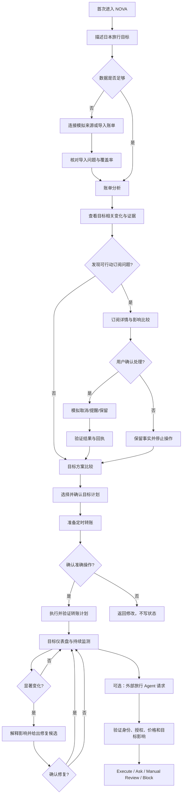

# NOVA v0.6 User Flow

> 产品基线：`PRODUCT.md`
> 深化设计：`docs/superpowers/specs/2026-10-26-nova-v0.6-deepening-design.md`
> 主故事：Japan Trip Money Mission
> 核心场景：账单分析、订阅/代扣管理、智能转账

## 1. 文档目的

本文规定 NOVA v0.6 的逐屏用户行为、系统行为、Agent 行为、确认节点、错误分支与恢复路径。实现者不得用固定跳转、预选结果或演示注入按钮替代这里定义的用户输入和状态变化。

所有余额、交易、订阅、转账和外部请求均为模拟数据，但交互语义应与真实金融任务一致。

## 2. 参与者

| 参与者 | 责任 |
| --- | --- |
| 用户 | 描述目标、核对数据、修改假设、确认或拒绝写操作 |
| NOVA Agent | 理解意图、选择 Skill、追问必要信息、组织解释和候选 |
| Deterministic Services | 解析结构化数据、计算、权限、风险、执行、验证和状态机 |
| Simulated Data Sources | 提供银行卡、微信支付、支付宝和账单导入批次 |
| External Travel Agent | 提交经过签名的模拟旅行服务请求 |
| Demo Controller | 在比赛前重置 Fixture 和故障状态；不属于用户流程 |

## 3. 总体流程

## 4. 全局流程规则

1. 每个屏幕只有一个主任务。
2. 返回、刷新和重新打开后恢复服务端任务状态。
3. Preview、Approval 和正式状态必须分离。
4. 写操作前显示准确参数；按钮必须描述具体动作。
5. 关键参数改变后，旧 Preview 和 Approval 立即失效。
6. `unknown` 不是成功；先查询状态，不重复执行。
7. 模型不可用时进入有标识的确定性降级，不丢失已核验数据。
8. 用户拒绝某项判断后，不继续生成针对该判断的写操作。
9. 技术枚举和内部工具名不出现在用户界面。

## 5. Flow 0：首次进入与创建目标

### 5.1 F0-01 Value Preview

| 项目 | 说明 |
| --- | --- |
| 用户看到 | “告诉 NOVA 你想完成什么，它会先判断是否可行，再只在真正影响目标时提醒你。” |
| 主 CTA | “创建一个目标” |
| 次要入口 | “查看模拟示例”只能解释能力，不直接载入完整目标状态 |
| 系统行为 | 创建匿名模拟会话，不自动创建目标或连接数据 |
| 验收 | 用户可跳过教学；返回时不重复强制展示 |

### 5.2 F0-02 Goal Conversation

用户示例：

> “我想明年六月底去日本，预算八千，已经存了两千，应急金两万不能动。”

NOVA：

- 提取目标、日期、已存金额和保护资金。
- 将每个字段标记为用户明确提供、系统推断或未知。
- 只有缺失信息会实质影响判断时才追问。
- 不在此阶段判断可行性或承诺完成日期。

### 5.3 F0-03 Goal Draft Review

页面展示：

- 目标名称。
- 金额与币种。
- 日期。
- 已存金额。
- 不可触碰资金。
- 仍待确认的信息。

主 CTA：“确认目标草案”。

确认只保存目标草案，不激活计划、不创建 Mandate、不启用监测。

### 5.4 分支

| 条件 | 系统行为 | 用户恢复路径 |
| --- | --- | --- |
| 日期模糊 | 展示解释后的日期范围 | 用户选择准确日期 |
| 已存金额缺失 | 不默认使用总预算 | 询问当前已存金额，可明确填 0 |
| 用户取消 | 标记任务取消 | 从空白工作台重新开始 |
| Prompt Injection | 阻断指令内容 | 说明只能处理目标信息，不执行其中操作 |

## 6. Flow 1：数据连接与账单导入

### 6.0 权威数据规则

- 账单文件只增加历史交易证据，不替换模拟账户、当前余额或目标已存金额。
- 当前余额来自模拟连接的账户快照，或用户在独立步骤明确录入并确认的余额快照。
- 旅行金已存金额来自旅行金模拟账户；若该账户不存在，则使用 Goal Draft 中用户确认的 ¥2,000。
- 只有账单、没有余额快照时，允许进入账单分析，但现金流只显示区间，不开放智能转账 CTA。
- 比赛构建默认只开放合成样例文件和模拟连接；任意用户文件入口由合规功能开关控制，原始文件不得发送给模型。

### 6.1 F1-01 Data Choice

展示两种平级路径：

1. 连接银行卡、微信支付、支付宝模拟来源。
2. 导入账单文件。

主演示固定使用合成样例；若任意文件功能开关关闭，第二个入口写为“导入 NOVA 合成样例”，不得展示一个最终会失败的系统文件选择器。

每种路径说明：读取内容、用途、保存方式、可撤销性，以及“不包含扣款或转账权限”。

### 6.2 F1-02 Import File

| 步骤 | 用户行为 | 系统行为 |
| --- | --- | --- |
| 选择文件 | 选择 CSV/XLSX/PDF | 验证大小、格式和是否加密 |
| 识别来源 | 确认平台与账户 | 解析字段并给出识别置信度 |
| 映射字段 | 必要时修正日期/金额/商户列 | 保存映射 Preview，不写正式 Twin |
| 预览 | 查看覆盖日期和记录数 | 识别重复、退款、内部转账和缺失项 |
| 确认导入 | 明确确认本批次 | 写入批次、更新数据质量和 Twin Version |

### 6.3 F1-03 Import Review

屏幕按优先级展示：

1. 阻断问题：金额/日期无法解析、文件损坏。
2. 需要核对：不确定分类、疑似重复、退款对应关系。
3. 信息提示：缺失来源、覆盖不足、币种假设。

用户可逐项接受、修改或排除。批量操作不得默认选择不可逆处理。

### 6.4 F1-04 Data Coverage

完成页回答：

- 已读取哪些来源。
- 覆盖多少天。
- 有多少笔可用于分析。
- 哪些数据仍缺失。
- 当前可以回答哪些问题、不能回答哪些问题。

主 CTA：“开始分析账单”。

### 6.5 错误与恢复

| 错误 | 行为 | 恢复 |
| --- | --- | --- |
| 不支持模板 | 不导入部分猜测结果 | 下载示例模板或使用模拟连接 |
| 文件重复上传 | 显示已有批次 | 查看原批次或取消本次 |
| 部分行失败 | 不静默丢弃 | 下载问题清单、修正后重试 |
| 来源连接失败 | 保留健康来源 | 单独重试失败来源 |
| 用户撤销批次 | 展示将受影响的结论 | 确认后撤销并使相关 Preview 失效 |

## 7. Flow 2：官方场景一——账单分析

### 7.1 F2-01 Analysis Entry

入口：

- 数据完成页“开始分析账单”。
- 首页“这个月有什么值得注意？”
- 对话“帮我看看这个月的支出有没有问题”。

Agent 先明确分析目标：总览、异常、订阅或目标影响。只有无法合理判断时才追问。

### 7.2 F2-02 Analysis Progress

只展示真实任务阶段：

1. 核对数据覆盖。
2. 整理支出类别。
3. 比较历史基线。
4. 识别周期扣费与异常。
5. 评估旅行目标影响。

用户可以安全取消。取消后保留已完成的只读结果，不生成写操作。

### 7.3 F2-03 Bill Brief

首屏只显示：

- 一句结论。
- 本月总支出和较历史变化。
- 最值得关注的 1—3 项。
- 对旅行目标的影响。
- 一个主 CTA。

示例：

> 本月总支出仍在可控范围，但两项变化值得核实：视频会员即将按新价格续费，外卖与打车连续三周高于过去水平。按当前计划，旅行目标仍可完成，但首月余量会减少约 ¥420。

### 7.4 F2-04 Evidence Drawer

点击任何结论后展示：

- 已知事实。
- 系统推测。
- 需要核实。
- 使用的数据来源和截至日期。
- 相关交易列表。
- 排除的退款/转账。
- 计算假设和限制。

### 7.5 F2-05 User Correction

用户可以：

- 修改交易分类。
- 标记退款或内部转账。
- 说明一次性支出。
- 否认订阅判断。
- 补充遗漏来源。

修正后重新计算，旧结论标记为已更新，不直接删除历史证据。

### 7.6 账单分析验收

- 结论不是只有图表，必须给出下一步。
- 结论至少能下钻到一笔来源交易或明确假设。
- 数据不足时不生成完成日期或确定异常原因。
- 用户修正一笔关键交易后，目标影响随之变化。

## 8. Flow 3：官方场景二——订阅/代扣管理

### 8.1 F3-01 Subscription Candidate

账单分析发现一项候选订阅：

- 商户：CloudBox Plus。
- 最近扣款：¥68。
- 周期：每月。
- 下次预计扣款：2026-11-05。
- 当前付费期：至 2026-11-04。
- 价格变化：较前三个月增加 ¥10。
- 证据：连续四个月相近日期扣款。

当证据不足时，页面必须写“可能是订阅”。

### 8.2 F3-02 Subscription Detail

页面展示：

- 扣费历史。
- 周期和预计下次扣款。
- 价格变化。
- 用户提供的使用状态。
- 保留与取消对旅行目标的差异。
- 处理限制，例如部分服务只能跳转商户。

可选操作：

- 保留。
- 续费前提醒。
- 准备取消。
- 这不是订阅。

### 8.3 F3-03 Prepare Cancellation

用户选择“准备取消”后：

- NOVA 查询可用处理方式。
- 如果可以模拟 API 取消，准备写操作。
- 如果只能由商户处理，准备跳转/操作指引，不伪装已取消。
- 展示服务、账户、预计避免金额、生效时间和可能损失。

### 8.4 F3-04 Approval

批准页必须写明：

> 确认模拟取消 CloudBox Plus 月度订阅。预计从 2026-11-05 起不再扣取 ¥68；本次不会退款。取消结果仍需服务端验证。

按钮：

- “确认模拟取消 CloudBox Plus”
- “返回修改”

不得使用“继续”。

### 8.5 F3-05 Execute and Verify

可能结果：

| 结果 | 用户文案 | 下一步 |
| --- | --- | --- |
| 成功 | 已取消，下次不再续费 | 查看回执 |
| 失败 | 未取消，原因明确 | 修改信息或使用商户指引 |
| 需要商户操作 | NOVA 无法代为完成 | 打开步骤清单 |
| 状态未知 | 暂时无法确认是否成功 | 查询状态，不重复提交 |

主故事中的成功回执还必须显示：

- 商户模拟操作 ID。
- 取消提交时间 `cancelledAt`。
- 自动续费关闭生效时间 `effectiveAt`。
- 当前服务可用至 `paidThrough=2026-11-04`。
- `nextChargeSuppressed=true`，因此 2026-11-05 起商户模拟器不会再生成 ¥68 扣费。

成功不表示立即终止服务或退款。商户模拟器拥有取消状态和未来扣费的权威数据；预测服务不得根据前端按钮点击自行假设节省。

### 8.6 F3-06 Goal Recalculation

只有成功或经用户确认的状态变化才重新计算目标。失败和未知状态不得把预计节省计入计划。

### 8.7 订阅管理验收

- 用户可以否认识别结果，系统不会继续准备取消。
- Approval 参数与执行参数完全一致。
- 状态未知时重复点击不会再次取消或重复记账。
- 回执展示处理对象、时间、结果、目标影响和后续动作。

## 9. Flow 4：目标方案与激活

### 9.1 F4-01 Goal Readiness

展示：

- 当前判断。
- 数据充分性。
- 目标金额、已存金额和剩余时间。
- 日期级最低余额。
- 主要假设。
- 保护资金是否受影响。

状态图标必须匹配 `insufficient_data`、`on_track`、`at_risk` 和 `infeasible`，不能统一使用绿色对勾。

### 9.2 F4-02 Plan Compare

最多三个候选，每个展示：

- 首月投入。
- 后续周期投入。
- 预计完成日期或范围。
- 最低预计余额。
- 对其他目标的影响。
- 主要代价。
- 关键假设。

推荐只能是建议，不默认选中。

### 9.3 F4-03 What-if

用户修改：目标日期、金额、月投入上限、保护资金、收入日、允许跳过月份。

系统生成新的只读 Preview，并保留与当前计划的差异。用户关闭页面后 Preview 可恢复但不会自动生效。

### 9.4 F4-04 Plan Approval

准确展示将写入的目标参数和激活效果。确认前不创建定时转账、不启用监测。

### 9.5 F4-05 Plan Receipt

确认后展示：

- 已激活的投入节奏。
- 仍需设置的下一步。
- “安排每月转入旅行金账户”主 CTA。

## 10. Flow 5：官方场景三——智能转账

### 10.1 F5-01 Transfer Intent

入口：

- 计划回执 CTA。
- 对话“工资到账后帮我每月存一千到旅行金账户”。
- 目标 Dashboard。

### 10.2 F5-02 Clarify Only What Matters

必要字段：

- 来源账户。
- 目标账户。
- 金额。
- 首次日期或相对工资日。
- 频率。
- 结束条件。

如果用户说“工资到账后”，但系统不知道工资日，必须追问或展示可编辑假设。

P0 频率只提供：一次性、每月。每月计划又分为固定日和实际工资事件触发；不展示每周、每年或自定义周期。每个目标最多一个激活的月度计划。

### 10.3 F5-03 Schedule Simulation

系统先模拟未来至少三个周期，展示：

- 每次计划转入日期。
- 转入前后余额。
- 最低余额及日期。
- 与固定账单/订阅的冲突。
- 保护资金状态。
- 失败规则。

主故事绑定真实模拟工资事件：预计工资 ¥8,500，通常在每月 25 日进入尾号 2048 的工资卡；有效匹配要求银行来源、收入类别、确定性工资分类、金额 ¥7,650—¥9,350，且在 23—27 日入账。检测到账后安排次日 09:00。页面将“26 日”标为正常情况下的预览日期，不把它显示为无条件固定执行日。

### 10.4 F5-04 Transfer Approval

批准文案：

> 每月检测到尾号 2048 工资卡收到符合规则的工资后，次日 09:00 模拟转入旅行金账户 ¥1,000。正常预计首次为 2026-11-26；达到 ¥8,000 或 2027-06-30 时停止。若当月 27 日 23:59 前仍未检测到工资，本期跳过且不会事后补扣。预计最低可用余额 ¥3,240，不使用应急金。

按钮：“确认创建每月 ¥1,000 模拟转账”。

### 10.5 F5-05 Activation

执行链：

1. 检查 Approval 是否仍有效。
2. 检查账户、余额预测和保护资金。
3. 创建 `TransferSchedule`。
4. 查询写入结果。
5. 生成 Receipt 和 Activity。

此处确认的是整个受限计划。之后每期若金额、来源、目标、触发和结束条件都未变化，可沿用该计划授权自动执行；每次仍执行 Risk、幂等和 Verify，并生成独立回执。

### 10.6 F5-06 Scheduled Execution

到期时：

- 使用独立幂等键执行。
- 成功后更新账户、目标进度和下一次日期。
- 余额不足时不透支、不动保护资金，计划进入需要处理状态。
- Timeout 时进入 `unknown` 并自动对账。
- 预期工资日至 27 日 23:59 仍未检测到匹配的工资事件时，本期标记 `skipped_missing_trigger`；不得改用 26 日固定执行，也不得在工资晚到后自动补扣。

### 10.7 F5-07 Manage Schedule

用户可以查看、暂停、恢复、修改和取消。

- 暂停与取消需要明确确认。
- 提高金额、改变账户或延长结束日期需要新 Approval。
- 仅改变备注不触发资金审批，但仍记录历史。

### 10.8 智能转账验收

- 操作不是仅存在于后端工具列表。
- 用户能在一个连续流程中理解资金来源、去向、时间和目标影响。
- 余额不足、过期 Approval、重复请求和 Timeout 均有可恢复结果。
- 创建计划不等于执行首笔转账，两者分别有状态和回执。

## 11. Flow 6：持续监测与修复

### 11.1 F6-01 Quiet Monitoring

默认不为普通波动创建即时红点。首页显示最近数据时间和当前目标状态。

### 11.2 F6-02 Material Change

触发示例：

- 订阅价格上涨。
- 工资延迟。
- 旅行相关大额支出。
- 定时转账失败。
- 外部机票报价变化。

只有同时满足相关、重要、可行动和证据充分才即时提醒。

### 11.3 F6-03 Impact Detail

页面顺序：

1. 发生了什么。
2. 证据和来源。
3. 影响哪个目标。
4. 不处理可能怎样。
5. 最小修复候选。
6. 需要什么确认。

### 11.4 F6-04 Repair

修复可以是：

- 调整本月转入。
- 延后目标日期。
- 暂停下一次转账。
- 处理新增订阅。
- 忽略本次提醒。

每个修复先 Preview，确认后再写入。

## 12. Flow 7：跨场景旅行 Agent 加分段（P1 Stretch）

本 Flow 有完整设计，但不属于 v0.6 核心实现、三场景验收或 9 分钟主演示的完成条件。核心 P0 未全部通过前，不进入开发。

### 12.1 F7-01 Create Mandate

用户说：

> “允许已验证的旅行助手在北京到东京往返机票总价不超过 ¥2,500、可免费退改时替我下单，有效期到本周日。”

NOVA 解析为可编辑字段：

- Agent 身份。
- 路线和用途。
- 商户/航司范围。
- 总价与费用上限。
- 退改条件。
- 乘机日期范围。
- 次数。
- 有效期。

用户确认后才创建 Mandate。

### 12.2 F7-02 Request Inbox

真实模拟请求进入 Inbox，展示：

- Agent 身份与验证状态。
- 航班/服务。
- 商户。
- 基础价、税费和总价。
- 退改条件。
- 请求有效期。
- 对目标和余额的影响。

用户不选择期望结果。

### 12.3 F7-03 Decision

系统根据请求决定：

- `Execute`：完全匹配 Mandate 且风险通过。
- `Ask`：用途、类别或关键条件需要用户确认。
- `Manual Review`：金额接近上限、设备风险或数据冲突。
- `Block`：超额、过期、身份失败或影响保护资金。

### 12.4 F7-04 Outcome

执行后通过状态事件更新 Receipt。价格、商户、退改条件变化使旧 Approval/Mandate 匹配结果失效。

## 13. 离线、模型故障与权限恢复

| 状态 | 可做 | 不可做 |
| --- | --- | --- |
| 离线 | 查看最近安全摘要、已完成回执 | 新导入、分析、确认、执行 |
| 模型不可用 | 使用确定性解析和固定白名单流程 | 伪装为模型完成开放式理解 |
| 数据过期 | 查看历史结果 | 生成新的即时风险结论 |
| Approval 过期 | 重新生成准确快照 | 使用旧 Token 执行 |
| 执行未知 | 查询和对账 | 直接重试写操作 |
| 外部 Agent 身份失败 | 查看阻断原因 | 读取支付凭证或继续执行 |

## 14. Screen Inventory

| ID | 页面 | 主任务 | 主要状态 |
| --- | --- | --- | --- |
| S01 | Value Preview | 理解价值 | default / returning |
| S02 | Goal Conversation | 描述目标 | listening / parsing / clarification |
| S03 | Goal Draft Review | 核对目标 | complete / missing / invalid |
| S04 | Data Choice | 选择数据路径 | empty / connected / partial |
| S05 | Import File | 选择与解析文件 | uploading / parsing / failed |
| S06 | Import Review | 修正导入问题 | blocked / needs_review / ready |
| S07 | Data Coverage | 理解数据充分性 | sufficient / partial / stale |
| S08 | Bill Brief | 看懂本月变化 | stable / attention / insufficient |
| S09 | Evidence Drawer | 核实依据 | facts / assumptions / missing |
| S10 | Subscription Detail | 决定订阅处理 | candidate / verified / disputed |
| S11 | Subscription Approval | 确认处理 | valid / expired / changed |
| S12 | Receipt | 理解结果 | succeeded / failed / unknown |
| S13 | Goal Readiness | 判断能否实现 | four feasibility states |
| S14 | Plan Compare | 比较取舍 | 1—3 candidates / none |
| S15 | What-if | 修改假设 | preview / stale / invalid |
| S16 | Plan Approval | 激活计划 | valid / expired |
| S17 | Transfer Builder | 准备转账 | draft / conflict / ready |
| S18 | Transfer Approval | 确认转账 | valid / changed / expired |
| S19 | Goal Dashboard | 跟踪目标 | on_track / at_risk / paused |
| S20 | Impact Detail | 理解并修复变化 | active / deferred / resolved |
| S21 | Mandate Builder | 定义授权边界 | draft / invalid / confirmed |
| S22 | Request Inbox | 查看外部请求 | unread / review / resolved |
| S23 | Request Detail | 判断请求 | execute / ask / review / block |
| S24 | Activity Detail | 查看处理证据 | completed / failed / unknown |

## 15. 响应式行为

### 15.1 360px

- 单列消息与任务卡。
- 证据、筛选和次要设置使用底部抽屉。
- 方案比较横向滑动时提供页码和可见焦点，不隐藏关键信息。
- Approval 主按钮固定在安全区上方。

### 15.2 768px

- 分析摘要单列，候选和证据可以双列。
- 导入核对表保留可读列，次要字段进入展开区。

### 15.3 1440px

- 对话区约 32%，任务画布约 68%。
- 当前任务、证据和预览保持同步选择。
- 用户可折叠对话或画布，不强制展示技术日志。

## 16. 埋点与验收事件

| 事件 | 目的 |
| --- | --- |
| `goal_draft_confirmed` | 首次目标完成率 |
| `data_path_selected` | 模拟连接/导入选择 |
| `import_review_completed` | 数据进入成功率 |
| `bill_evidence_opened` | 结论可解释性使用 |
| `subscription_candidate_corrected` | 识别误差与用户纠正 |
| `subscription_action_confirmed` | 场景二完成率 |
| `goal_plan_activated` | Goal-first 核心转化 |
| `transfer_schedule_confirmed` | 场景三完成率 |
| `operation_unknown_reconciled` | 恢复能力 |
| `risk_repair_applied` | 持续价值 |
| `external_request_resolved` | 跨场景能力 |

埋点不得包含原始交易文本、完整账户、导入文件内容或授权 Token。

## 17. 演示主路径

1. 输入日本旅行目标。
2. 导入或连接模拟账单。
3. 在数据质量页核对一项分类。
4. 查看账单分析和证据。
5. 处理一项即将涨价的订阅。
6. 比较并激活目标计划。
7. 创建并确认定时转账。
8. 推进服务端模拟事件，展示一次目标风险与修复。
9. 时间允许时展示真实签名外部请求。

演示时不打开 Demo Controller。所有 Fixture 控制在演示开始前完成。

