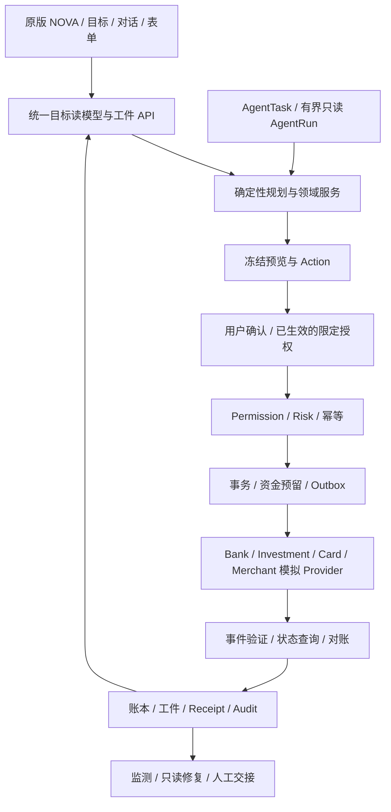

# 方案 B：工程架构、资金语义与执行契约

设计规格，未实现项不应作为现有能力宣传。复用 React/Express/SQLite/Zod、共享契约、AgentTask/Run、Approval、Operation、Receipt 和审计；不引入新 Agent 框架或真实金融连接。

## 1. 依赖架构

Provider 是具有独立业务状态和查询能力的模拟系统。前端不提交“结果为成功”；只有隔离的 demo-control 能配置下一事件或故障，产品 API 返回真实模拟执行结果。

## 2. 资金模型：单一可用资金依据

### 2.0 三种时间语义

WallClock 用于五分钟确认时效、签名请求时效和运行超时；FinancialClock 用于账单、工资、目标、交易日/结算；Provider 事件另有可验证的发生时间与顺序版本。模拟跳到明年不能把审批 TTL 也随意延长，真实系统时钟变化也不能把演示财务余额标成“刚更新”。

所有时间策略通过可注入 Clock 服务提供，测试不依赖 sleep 才能完成 T+1。用户界面同时明确财务演示日与必要的真实操作时间。

### 2.1 金额精度

现金以整数分存储，币种必须明确。R1 单币种 CNY；禁止用错误汇率把 JPY 金额直接混入。单字段值限定在 JS safe integer；跨金额/份额乘除使用 BigInt 中间计算并校验转换范围。

投资份额使用微份额整数（1 份=1,000,000 单位）；净值使用“每份多少分×1,000,000”的整数。JSON 对可能超 safe integer 的量使用十进制字符串，Zod 严格校验；不得 JSON.stringify BigInt。

### 2.2 状态分层

| 对象 | 含义 | 是否立即可支付 |
| --- | --- | --- |
| PostedCash | 已核对入账现金 | 还需扣除预留、保护和预算约束 |
| ActiveReservation | 尚未捕获的资金冻结 | 否 |
| PendingReceivable | AA、退款等待收 | 否 |
| InvestmentPosition | 已确认持仓份额及估值 | 否 |
| PendingSettlement | 已赎回未到账或申购待确认 | 否 |
| GoalAllocation | 已到账资金的目标归属 | 只能在该目标或经新确认再分配 |
| CapturedPayment | 已确认支付 | 已花出，不再重复冻结 |
| CreditLimit | 卡片授信额度 | 不是现金，不进入目标已存 |

R1 主故事使用借记支付。未来启用信用卡付款时必须新增信用负债和还款：消费增加 usedCredit/liability，不能扣/加虚构现金；目标资金要为还款保留且只计算一次。退款退回信用额度不等于活期退款；还款与原目标支出的关系需以唯一资金引用去重。未完成这套模型时，不把信用卡开放成旅行付款来源。

以账户为单位：`accountSpendable = postedBalance - activeHolds - protectedReserve`。

以目标为单位：`goalSpendable = 该目标在该账户可用分配额`；需同时满足账户实际可用与目标预算。分配额在生成读模型时扣除属于该目标的活跃预留，不能二次扣同一预留。

其他目标的分配不是银行实际冻结，但不可被当前任务擅自使用。未分配现金才可用于新目标；重新分配必须明确确认。跨账户、跨目标不重复累计同一资金。

明确分配与预留的重叠：`allocatedCents` 是仍在账户里的目标现金，包含已为该目标预留的部分。`goalSpendable = allocatedCents - holdsForThatAllocation`。全账户应满足 `sum(goalAllocations) + holdsWithoutGoalAllocation ≤ postedBalance - protectedReserve`；不是把已包含在分配内的 hold 再扣一次。

现金捕获时同步减少该目标的现金分配并计入有效目标支出。例如分配 800000、其中 hold 500000，可用 300000；捕获 280000 后分配 520000、hold 220000，可用仍 300000，已支付 280000 单独计入覆盖。

### 2.3 不变量

- 现金总账每个 Journal 的借贷腿平衡；对外资金流有明确的外部清算对手科目，费用单列。
- 所有活跃预留不能超过相应账户授权可用额；并发创建预留在同一事务重检。
- 同一笔支付确认捕获时，扣现金与 consume 原预留在同一事务；不能余额已经扣除仍保留同金额活跃冻结。
- 同一源资金的目标分配总额不能超过可分配现金；被预留的分配额不能再分配。
- 应收到账、赎回结算、退款到账分别依据唯一权威事件入账，重复事件无效。
- 投资可赎份额=确认份额−活跃赎回冻结份额；负份额、重复释放和超额赎回禁止。
- 持仓估值变化不是现金流；信用额度变化不是收入。

### 2.4 已知扣款与未知订单分开

资金已确认扣账、出票未知时，Payment 可为 captured、Booking 为 unknown；不能为了订单未知再次扣款或再次扣预留。

资金结果本身未知时，保留原预留，查询 Provider。若余额快照已包含该笔捕获，必须通过 operation/event 引用关联并原子消费相应 hold；不能既按新余额扣款又继续冻结。

## 3. 核心契约

所有新增类型在 `shared/contracts.ts` 统一导出，可拆入 `shared/money-mission.ts` 和领域文件；输入严格 Schema，服务端工件和 UI 读模型分开。

| 类型 | 关键字段 |
| --- | --- |
| GoalContract | goalId、revision、amountCents、deadline、protectedSources、priorities、allowedAdjustments |
| GoalAllocation | id、goalId、accountId、sourceLotId、allocatedCents、version |
| Journal / LedgerEntry | id、eventId、operationId、accountId、side、amountCents、currency、effectiveAt |
| FundsReservation | id、operationId、accountId、goalId、amountCents、status、expiresAt、scopeHash |
| Recipient | id、identityVersion、displayName、maskedPhone、aliases、destinationRef、verifiedAt |
| TransferIntent | recipientVersion、source、destinationRef、amountCents、fees、executionRule、hash |
| SplitBill | expenseEvidenceId、payer、participants、sharesCents、dueAt、status |
| CollectionEvent | providerEventId、splitBillId、participantId、amountCents、verifiedAt |
| Report / Investigation | period、coverage、ruleVersion、claims、evidenceRefs、userFeedback |
| Subscription | merchantId、cadence、price、renewalAt、paidThrough、cancellationPolicy、version |
| RiskProfile | answers、derivedRiskLevel、liquidityNeed、useByDate、ruleVersion、expiresAt |
| InvestmentProduct | riskLevel、minHolding、tradeCalendar、cutoff、feeRule、NAVRef、status、termsVersion |
| InvestmentOrder | kind、productVersion、amount/quantity、pricingRule、feeRule、status、operationId |
| InvestmentPosition | productId、confirmedQuantity、reservedQuantity、costCents、valuationRef |
| Settlement | orderId、netCents、expectedAt、status、verifiedEventId |
| Card | maskedNumber、type、settlementAccountId、status、controlsVersion、creditLimit/used |
| CardApplication / LimitRequest | requestedTerms、decision、approvedLimit、reasonCode、effectiveAt |
| AgentIdentity | providerId、keyId、allowedScopes、status、validUntil |
| MissionMandate | goalId、allowedMerchants/categories、caps、source、termsConstraints、validity、revision |
| SignedQuote | merchant、items、tax/fees、total、termsVersion、expiresAt、signatureRef |
| Checkout / Booking | quoteId、paymentId、fulfillment、status、providerOperationId、revision |
| MissionStep / Checkpoint | dependencies、artifactRefs、requiredApproval、status、lastEvent、recoveryOptions |
| ActionPreview | proposedParameters、beforeAfter、impacts、risk、versions、expiresAt、hash |
| OutcomeProof | taskId、source/approval/operation/receiptRefs、redactedSummary、integrityCheck |

转账 TriggerRule 使用区分联合：one_time（具体日期）、fixed_monthly（1–31 日或月末、缺日按月末收敛）、salary_event（已验证银行来源、金额范围、到账窗口、次日执行）。现有 SalaryTrigger 的 1–28 日限制不能直接拿来表示新的月末规则；新增版本兼容迁移。

每个规则冻结时区、执行时刻和允许的执行窗口。错过窗口不会静默追补；缺薪期次标 skipped 后，迟到事件也不能复活该期。R1 默认工资窗口 23–27 日、次日 09:00，其他合成收入按其已声明规则处理，不把自由职业收入硬套成工资。

`sourceLotId` 是资金归属/分配标识，不要求追踪每个物理货币单位；首次迁移时从权威期初余额创建，禁止从历史账单反推。

## 4. 生命周期

| 领域 | 正常状态 | 异常/停止 |
| --- | --- | --- |
| Action | draft→prepared→confirmed→executing→verified | denied/expired/invalidated/failed/unknown |
| Hold | active→consumed 或 released | expired；unknown 挂在原 Operation 上处理 |
| Transfer | prepared→submitted→succeeded | rejected/failed/unknown；周期 skipped 单独记录 |
| AA | draft→requested→partially_collected→collected | closed/cancelled；已收事件仍有效 |
| Subscription | candidate→user_confirmed→cancel_pending→cancelled_verified | disputed/rejected/unknown/manual_required |
| Investment buy | prepared→submitted→pending_pricing→filled→settled | rejected/unknown/cancel_pending/cancelled |
| Investment redeem | prepared→shares_reserved→submitted→priced→pending_settlement→settled | rejected/unknown；只按原订单释放份额 |
| Card application | prepared→submitted→under_review→approved→active | rejected/unknown |
| Card status | active↔temporarily_locked；active/locked→lost | lost 不进入普通 unlock |
| Booking | quoted→awaiting_approval→submitted→confirmed→fulfilled | expired/declined/unknown/cancel_pending/cancelled |
| Refund | requested→accepted→pending_settlement→settled | rejected/unknown；未结算不增加余额 |
| Mission | investigating→planned→awaiting_approval→executing→funded/ready→fulfilled | blocked/partially_completed/unknown/cancelled |

业务状态与资金状态独立关联。例如 Booking confirmed 尚未履约；Payment captured 可在 Booking unknown 时已成立；退款已申请不能触发余额恢复。

## 5. 精确确认与授权

ActionPreview 至少绑定 session、task/goal revision、对象版本、金额/费用、来源/去向、报价/条款、时效和幂等输入哈希。用户确认时重新验证版本与风险；不允许模型自发创建“用户已确认”的字段。

短期预览沿用 Twin Version 失效策略。长期已激活计划以冻结规则和授权上限持续执行，每期用最新余额/风险重新检查；不能要求未来 Twin Version 永远等于激活时版本。

目标改大不自动扩展旧计划额度；改变商户、收款人、费用、卡、资金账户或退改条款时，按冻结授权重新确认。R1 默认订单重大字段变化都重新确认；可调价格容忍属于 R1+ 且必须由用户明确设置。

审批策略：

| 操作 | 用户动作 |
| --- | --- |
| 读取/预测/比较 | 数据权限内直接查询，解释来源 |
| 导入提交/撤销、用户分类修正 | 明确确认对历史分析的改变，不改变余额 |
| 新转账/AA 请求/申赎/卡控制 | 各自冻结预览和明确确认 |
| 激活周期计划 | 一次确认准确规则；每期不重复弹窗，仍做风险/幂等/验证 |
| 订单付款 | 逐单准确确认或已经明确生效的限定授权；不能仅凭目标合同 |
| 支付未知后的查询 | 读取原操作；不产生新的资金副作用 |
| 补偿/退款申请/替代订单 | 根据其副作用独立确认；不扩展原授权 |

Passkey 复用已有能力，并按现有风险策略触发；设备不支持时采用明确可见的模拟确认降级，不伪造“生物验证成功”。

## 6. 原子执行与恢复

### 6.1 单动作写入

1. 校验会话、权限、输入、对象版本和幂等请求哈希。
2. 读取最新资金/卡/产品/报价状态，确定性 Risk。
3. 在 SQLite 事务中消费批准、创建 Operation、建立资金/份额预留、写 Outbox 与审计；确认前不提交 Provider 资金请求。
4. Worker 领取 Outbox，使用同一个 provider idempotency key 提交。
5. 保存 Provider 操作 ID；超时标 unknown，不新建写操作重试。
6. 验证签名事件或查询原操作，在事务中更新账本、预留、业务工件、Receipt、Audit、Inbox/监测事件。

Outbox 网络调用不能包在长时间数据库锁中。Provider 也必须实现幂等和状态查询，才能真实模拟“提交成功但回包丢失”。

### 6.2 多订单 Saga

依赖：报价与条款有效 → 授权 → 资金预留 → 卡/账户复核 → 各订单提交 → 各自验证 → 目标读模型。

若两单中一单成功：成功单不重跑；未执行单可安全释放其独立预留；未知单保留未确定占用并查询。是否退款成功单必须依据条款、费用及用户选择；不承诺两个商户的原子回滚。

任务取消是停止未来步骤并尝试按条款处理未提交项；已提交未知项继续对账，不能释放全部预留后遗忘。

### 6.3 幂等与事件版本

- 唯一约束建议：`(session_id, operation_kind, idempotency_key)`，绑定 requestHash；同键不同参数返回冲突。
- 收款/结算/退款事件：`(provider_id, provider_event_id)` 唯一；重复不二次入账。
- 周期执行：`(schedule_id, period_key)` 唯一；跳过的期次不能被迟到工资复活。
- Worker：lease_owner/lease_until/attempt/next_attempt_at；重启后接管过期租约，先查原 Operation。
- 乱序事件按 provider revision 和合法状态迁移检查；旧事件不能把 settled 改回 pending。
- unknown 终止自动新写重试；查询退避建议 10s/60s/300s，三次仍未知进入 attention_required，原工件保留。

预留 TTL 只释放尚未提交或已证实未扣款且失效的操作。提交结果未知时，不能仅因为 TTL 到期就释放成可用现金；必须先查询/对账或进入人工处理。用户“取消任务”也不能绕过这条规则。

## 7. 理财精度、期限与定价

费用按冻结规则和整数舍入；示例赎回毛额 `floor(quantityMicro × navCentsScaled / 10^12)`。费用比例可用 basis points，按规则 ceil/floor；中间余分进入明确舍入科目，不消失。

金额申购和份额赎回分别建模；R1 对模拟产品明确采用已知报价成交或下个定价事件成交，不能一边确认未知 NAV、一边保证到账精确净额。

模拟交易日历固定为 Asia/Shanghai 周一至周五和声明的截止时间；未额外配置节假日时界面明确不代表真实银行日历。T+1 从订单约定的受理交易日计算，周末、截止后按规则顺延。

净值定价分两种：固定有效报价在变价/到期后必须重确认；下一定价时点订单冻结的是金额/份额指令、定价规则、费用上限和适用约束，不承诺未知成交份额。按已批准规则正常定价不等于越权变价，超出明确边界则暂停或拒绝。

赎回净额、已扣费用和到账事件形成独立 Settlement；即使是同一服务进程，也不能用前端倒计时结束代替结算事件。

## 8. Agent 与技能

### 8.1 确定性规划与最小修复

R1 使用受控任务模板和有界候选搜索，不让模型生成任意可执行 DAG。候选来自金额档位、允许日期、可用资金源、匹配产品、可用卡和已验证报价；先过滤硬约束，再比较用户改变、日期偏移、额外费用、已成功步骤影响和新确认数量。

最多评估 64 个候选，均用同一资金/日期引擎核验；输出三类真正不同方案及保持现状。对已成功订单的取消默认是高成本改变，只有用户允许且满足条款才进入候选。所谓“最小”只针对声明的候选空间，不宣称全局最优。

每个推荐保存 before/after、候选输入、规则版本、证据和不选其他方案的原因。R1 日期现金流完整核算最多 366 天；默认培训金可设为 2027-09-30，超出支持范围的目标显示覆盖边界，不冒充完整长期预测。

### 8.2 技能 Registry 和执行边界

现有 v0.6 保持十项 Registry 的历史记录；六场景版本拟扩展至十三项：保留原十项，新增 `recipient_and_split_coordinator`、`investment_lifecycle_manager`、`card_lifecycle_manager`。需同步更新原“恰好十项”测试与规格，不能偷偷让文档和代码互相矛盾。

Skills 6–7 在身份、Schema、接口、UI 和故障评测通过后才从 disabled 启用。跨场景的执行器属于确定性任务控制器，LLM 不能直接获得 execute/confirm 工具。

| 技能组 | 只读/准备工具示例 | 输出 |
| --- | --- | --- |
| 导入与分析 | read_import_quality、bill_summary、investigate_transaction、evidence_detail | 报告/证据/纠错建议 |
| 现金流与目标 | dated_forecast、compare_goal_allocations、search_minimal_repairs | 可比较且带约束结果的计划 |
| 联系人与 AA | resolve_recipient、preview_transfer、preview_split、collection_status | 消歧/预览/收款状态 |
| 理财 | risk_match、compare_products、preview_purchase/redeem、order_status | 适当性、费用、结算与订单预览 |
| 卡片 | card_status、preview_card_action、payment_readiness | 卡动作预览和支付阻塞原因 |
| 授权与 Inbox | parse_mandate_draft、inspect_agent_request、quote_compare | 可编辑授权/签名报价/意图偏离结果 |
| 监测解释交接 | read_material_outcomes、explain_claim、prepare_case_pack | 只读修复、来源与脱敏问题包 |

每个技能必须冻结：输入引用、权限范围、允许工具、输出 Schema、来源、确认点、失败恢复、至少正常/歧义/拒绝/过期/注入/未知六类评测。

单次运行建议统一为最多六决策、十二工具、45 秒和有限重试，作为共享配置而非散落 Prompt 常量。等待工资、赎回、商户的长任务持久化后退出模型循环，事件到来时只恢复必要步骤。

模型只能引用当前任务/会话的工件；结果版本过期必须重查。金额、日期、风险和状态由服务端决定。模型输出无效或停机时显示原因，保留直接表单与确定性执行路径。

## 9. 拟增 API 与复用入口

写动作统一返回 ActionPreview，再复用 `/api/agent/action` 确认；不新增可绕开审批的裸 execute 接口。

| 资源/路由族 | 用途 |
| --- | --- |
| `/api/goals/:id/mission` | 目标合同、准备/支付/履约进度、下一步、阻塞和来源 |
| `/api/goals/:id/allocations/preview` | 多目标分配与冲突预览 |
| `/api/funds/availability` | 按账户/目标/日期查询可用资金解释 |
| `/api/recipients/search` | 姓名/手机号/备注解析和脱敏候选 |
| `/api/transfers/preview`、`/api/split-bills/*` | 一次性/周期/AA 的预览与状态 |
| `/api/reports/*`、`/api/investigations/*` | 月/年度、分类修订与异常反馈 |
| `/api/subscriptions/*` | 通用详情、提醒、动作预览与商户状态 |
| `/api/investments/products|risk-profile|positions|orders/*` | 风险匹配、申赎预览、订单与结算 |
| `/api/cards/*` | 卡列表、申请/额度/限制/锁定/挂失预览及状态 |
| `/api/agent-requests/*`、`/api/mandates/*` | 签名请求、用户授权草稿与批准后的状态 |
| `/api/checkouts/*`、`/api/bookings/*` | 报价/订单查询、准备付款、取消/退款预览 |
| `/api/operations/:id/reconcile` | 查询原操作，写入验证后的状态 |
| `/api/missions/:id/proof` | 会话内脱敏证据摘要；不导出密钥或完整身份 |

错误有稳定 code：`RECIPIENT_AMBIGUOUS`、`FUNDS_RESERVED`、`GOAL_ALLOCATION_CONFLICT`、`RISK_PROFILE_REQUIRED`、`PRODUCT_NOT_SUITABLE`、`SETTLEMENT_PENDING`、`CARD_LOST`、`QUOTE_EXPIRED`、`TERMS_CHANGED`、`APPROVAL_STALE`、`OPERATION_UNKNOWN`。用户看到可行动中文，不直接看到技术栈日志。

## 10. 数据迁移与文件落点

历史对账建议区分 canonical transaction、source observations、category revisions。重复导入是多个来源观察同一历史事实，不是新增一笔消费。撤销一个批次只撤销其观察和结论来源；若其他有效批次仍证明同一笔交易，应重新归并而非永久丢失。历史批次撤销不能撤销已核对银行到账或正式资金账本。

新增目录建议 `server/ledger/`、`server/investments/`、`server/cards/`、`server/commerce/`；已有 statement/subscription/transfer/domain 服务保持职责，统一通过领域服务访问资金。

数据库增量建表：ledger_journals/entries、fund_reservations、goal_allocations、recipient_versions、split_bills/collection_events、investment_orders/positions/settlements、card_operations、checkout_orders、mission_steps、provider_events、outbox。

迁移步骤：

1. 记录迁移版本和会话边界；新表默认不改变旧行为。
2. 从权威余额创建期初 Journal 与保留的旧目标分配，既有账单只保留为分析证据。
3. 新资金路径启用后只允许账本服务写资金；旧工具成为适配器，避免两个计算源。
4. 余额投影、DemoState、专门工件表和审计在同一事务更新；失败全部回滚。
5. 老周期计划继续使用冻结授权，不能因迁移扩范围；不明旧状态暂停后重确认。
6. 干净库、旧库、重复迁移、回放与会话隔离均有集成测试。

不导入其他仓库依赖、构建产物或密钥；不重置用户工作区；不直接推 main。

## 11. 安全、隐私、可观测性与性能

Key 只在服务端环境；Provider 独立密钥和 Agent 白名单；签名请求含主体、时间、nonce、requestHash，回调需验签和重放防护。模拟 HMAC 不宣称等于 AP2 完整可验证凭证体系。

日志记录 task/operation 状态、耗时、稳定错误码和脱敏引用；不记录原文件、完整卡号、API Key、token、用户完整原文。前端只接收安全读模型。

证据匹配的 confidence 只说明规则/识别强弱；未做统计校准时不展示为交易欺诈概率、目标成功概率或收益概率。

审计记录批准内容和最终执行的一致性，不把 hash 链宣传成第三方不可抵赖或真实支付认证。

数千条数据在服务端筛选/分页/按索引汇总；年度报告、预测和方案缓存键含规则版本、数据版本与范围。金额修订使相关缓存失效。客户端不一次塞入数千条原始流水。

建议性能门槛：2,000 条报告计算 p95≤500ms；目标读模型≤1s；预览≤2s；外部模拟执行可异步；AI 响应单独报告首个状态与最终耗时。门槛需在明确硬件环境实测，未测不宣称通过。
